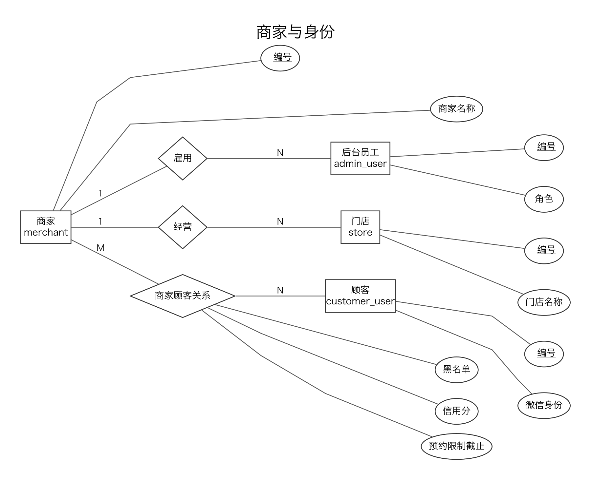
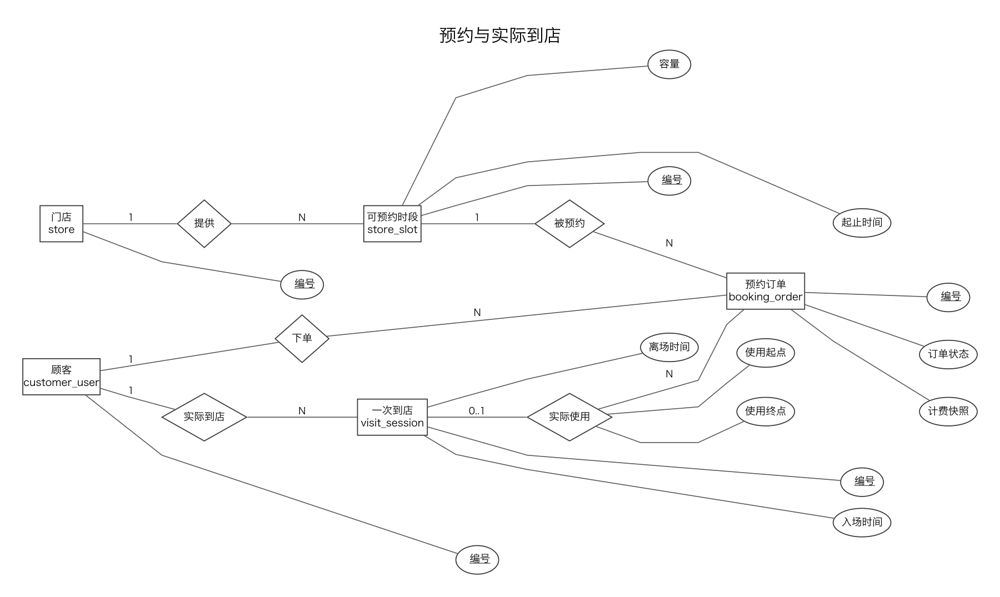
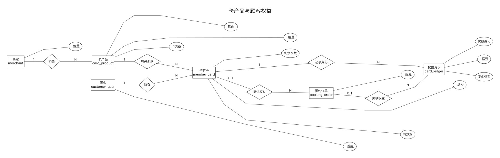
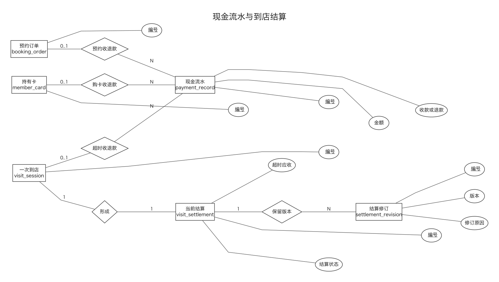
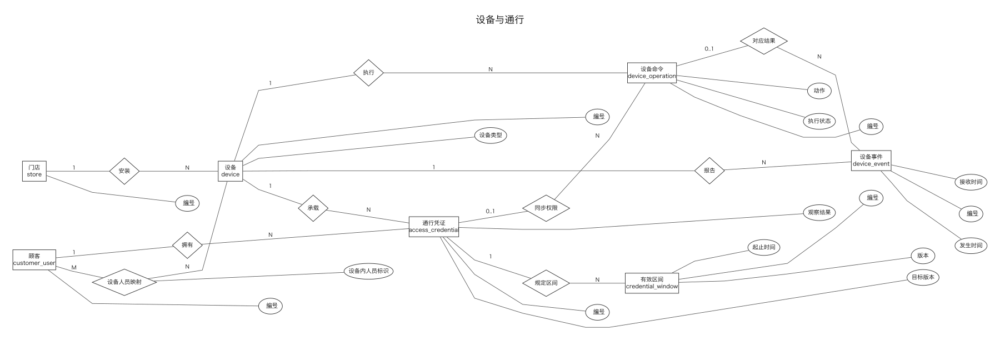
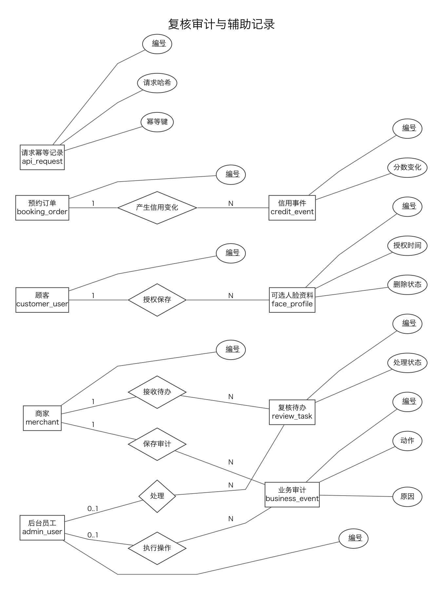
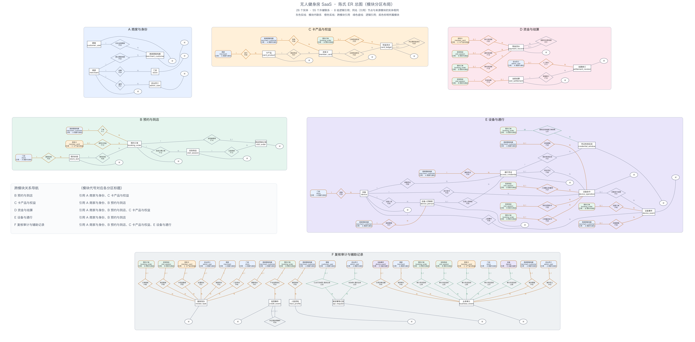

# 数据库设计与事务约定

整理日期：2026-11-16。整合字段字典v1.1、陈氏ER图、事务约定及首闭环实现细节；不改变schema v1.1、已确认业务规则或历史验证结果。目标MySQL 8.4，26表、369列、55外键、141索引。完整目标API见[接口文档](接口文档.md)。

- [字段字典](#database-dictionary)
- [陈氏ER分图](#database-er)
- [完整总图与联系核对](#database-overview)
- [并发、事务、fencing及查询](#database-transactions)
- [首闭环执行补充](#database-first-loop)
- [验证与复现](#database-validation)

<a id="database-dictionary"></a>
## 1 字段字典

日期：2026-11-12。与 [建表 SQL](../database/schema.sql) 同步，目标 MySQL 8.4。数据库覆盖完整已确认业务范围；首个迭代只实现时段付费闭环，可选人脸表暂不使用。

### 通用约定

- 时间点为 UTC DATETIME(3)，连接使用 `time_zone=+00:00`；营业时间及日报按 Asia/Shanghai 换算。API 返回带时区 ISO 8601。
- ID 为有符号 BIGINT，与 Java Long 一致，允许范围为1..9223372036854775807，API 返回正整数字符串。金额为整数分，API限制在JavaScript安全整数范围内。
- SQL列定义是精确的可空性和默认值约定。生成列禁止应用写入；必填无默认字段由业务明确填写。
- 无通用逻辑删除：账号、门店、设备停用；订单、资金、权益、审计和事件保留历史，应用账号禁止硬删事实。
- 复合外键限制商家、门店和持有人一致；不能代替接口鉴权。多态业务审计目标由服务层校验。
- JSON只存规则快照、脱敏协议、展示材料和证据。快照必要键见接口定义；核心订单、到店、资金和权益有独立关系记录。
- 凭证保留每个版本的多个有效区间；当前版本没有窗口代表撤销，不填平中间空档。
- 到期由卡valid_to派生，冻结和退款是独立状态。已售卡不随产品改价变化。
- 零元时段付费只记确认事件，不生成虚构正金额流水；卡扣次、覆盖和返次不计现金营收。

- merchant/store/user上下文、已售快照和余额投影是有意反规范化；不声明所有物理表严格满足3NF。快照只追加，类型化金额列为当前计算权威，流水与修订用于重算。
- 卡有效天数由固定类型策略派生：COUNT_CARD=180、MONTH_CARD=30；已售卡快照保存validDays，card_product不重复保存固定天数。
- settlement_revision、card_ledger、credit_event、business_event只追加，无updated_at，配套app_privileges.sql禁止应用账号更新或删除。
- 任务next_attempt_at非空且默认当前时间；attempts每次领取递增，配合租约和业务generation拒绝旧工作者写回。

### 表目录

| 表 | 职责 | 规则 |
|---|---|---|
| `merchant` | 商家 | Q001 Q013–Q018 |
| `customer_user` | 全局顾客 | Q009 Q010 Q016 |
| `admin_user` | 后台员工 | Q014–Q016 |
| `merchant_customer` | 商家顾客关系 | Q013 Q017 Q018 Q066 Q077 Q078 |
| `store` | 门店与运营规则 | Q019–Q029 Q037 Q096 Q097 |
| `store_slot` | 可预约时段 | Q020–Q025 Q029 Q033 Q035 |
| `card_product` | 商家卡产品 | Q079–Q084 |
| `member_card` | 用户持有卡与购买单 | Q079–Q084 |
| `booking_order` | 预约订单 | Q025 Q030–Q048 Q068–Q076 |
| `visit_session` | 一次实际到店 | Q040–Q064 Q093–Q095 Q102 |
| `visit_order` | 到店实际使用订单 | Q040–Q048 Q102 |
| `visit_settlement` | 到店结算当前投影 | Q061–Q067 |
| `settlement_revision` | 结算不可变修订 | Q057 Q067 Q104 |
| `payment_record` | 现金收退款流水 | Q036 Q065 Q067 Q074 Q083 Q101 |
| `card_ledger` | 卡权益流水 | Q080–Q084 |
| `device` | 设备注册和观察状态 | Q027 Q085–Q092 Q098 Q103 |
| `device_person` | 设备稳定人员映射 | Q087 |
| `access_credential` | 共享通行凭证 | Q047 Q071 Q085–Q089 |
| `credential_window` | 凭证版本与有效区间 | Q040 Q047 Q071 Q087 |
| `device_operation` | 设备命令与恢复任务 | Q049–Q059 Q071 Q085–Q089 Q096 |
| `device_event` | 设备事件收件箱 | Q049 Q052 Q057–Q059 Q075 Q098 Q103 |
| `business_event` | 业务时间线与审计 | Q057 Q067 Q078 Q104 |
| `review_task` | 异常待办和复核 | Q057 Q060 Q072 Q073 Q078 Q093–Q099 |
| `credit_event` | 爽约信用和冲正 | Q075–Q078 |
| `api_request` | 持久化写请求幂等 | Q035 Q059 Q074 |
| `face_profile` | 可选人脸资料 | Q011 Q012 Q092 |

### 1.1 merchant 商家

| 字段 | 精确 SQL 定义 | 说明 |
|---|---|---|
| `id` | `BIGINT NOT NULL AUTO_INCREMENT` | 主键；API返回字符串 |
| `name` | `VARCHAR(100) NOT NULL` | 商家显示名 |
| `status` | `VARCHAR(32) NOT NULL DEFAULT 'ACTIVE'` | ACTIVE DISABLED |
| `created_at` | `DATETIME(3) NOT NULL DEFAULT CURRENT_TIMESTAMP(3)` | 创建UTC时间 |
| `updated_at` | `DATETIME(3) NOT NULL DEFAULT CURRENT_TIMESTAMP(3) ON UPDATE CURRENT_TIMESTAMP(3)` | 更新UTC时间 |

主键和索引：

- `PRIMARY KEY (id)`

CHECK：

- `status IN ('ACTIVE','DISABLED')`

### 1.2 customer_user 全局顾客

| 字段 | 精确 SQL 定义 | 说明 |
|---|---|---|
| `id` | `BIGINT NOT NULL AUTO_INCREMENT` | 主键；API返回字符串 |
| `wx_app_id` | `VARCHAR(64) NOT NULL` | 微信AppID；开发身份使用独立命名空间 |
| `openid` | `VARCHAR(128) NOT NULL` | 后端换取的openid，不接受客户端指定 |
| `nickname` | `VARCHAR(64) NULL` | 昵称 |
| `phone_ciphertext` | `VARCHAR(255) NULL` | 手机号密文 |
| `phone_verified_at` | `DATETIME(3) NULL` | 验证时间，未验证为空 |
| `token_version` | `INT UNSIGNED NOT NULL DEFAULT 0` | 退出或禁用时递增 |
| `status` | `VARCHAR(32) NOT NULL DEFAULT 'ACTIVE'` | ACTIVE DISABLED |
| `created_at` | `DATETIME(3) NOT NULL DEFAULT CURRENT_TIMESTAMP(3)` | 创建UTC时间 |
| `updated_at` | `DATETIME(3) NOT NULL DEFAULT CURRENT_TIMESTAMP(3) ON UPDATE CURRENT_TIMESTAMP(3)` | 更新UTC时间 |

主键和索引：

- `PRIMARY KEY (id)`
- `UNIQUE KEY uk_customer_wx (wx_app_id,openid)`

CHECK：

- `status IN ('ACTIVE','DISABLED')`

### 1.3 admin_user 后台员工

| 字段 | 精确 SQL 定义 | 说明 |
|---|---|---|
| `id` | `BIGINT NOT NULL AUTO_INCREMENT` | 主键；API返回字符串 |
| `merchant_id` | `BIGINT NOT NULL` | 商家 |
| `username` | `VARCHAR(64) NOT NULL` | 全局唯一登录名 |
| `password_hash` | `VARCHAR(255) NOT NULL` | BCrypt哈希 |
| `role` | `VARCHAR(32) NOT NULL` | ADMIN OPERATOR |
| `permissions` | `JSON NOT NULL` | 操作员业务权限码数组，不允许自行扩权 |
| `status` | `VARCHAR(32) NOT NULL DEFAULT 'ACTIVE'` | ACTIVE DISABLED |
| `token_version` | `INT UNSIGNED NOT NULL DEFAULT 0` | 登录版本 |
| `created_at` | `DATETIME(3) NOT NULL DEFAULT CURRENT_TIMESTAMP(3)` | 创建UTC时间 |
| `updated_at` | `DATETIME(3) NOT NULL DEFAULT CURRENT_TIMESTAMP(3) ON UPDATE CURRENT_TIMESTAMP(3)` | 更新UTC时间 |

主键和索引：

- `PRIMARY KEY (id)`
- `UNIQUE KEY uk_admin_username (username)`
- `UNIQUE KEY uk_admin_user_m (merchant_id,id)`

CHECK：

- `role IN ('ADMIN','OPERATOR')`
- `status IN ('ACTIVE','DISABLED')`

外键（均 RESTRICT）：

- `(merchant_id)` → `merchant(id)`

### 1.4 merchant_customer 商家顾客关系

| 字段 | 精确 SQL 定义 | 说明 |
|---|---|---|
| `id` | `BIGINT NOT NULL AUTO_INCREMENT` | 主键；API返回字符串 |
| `merchant_id` | `BIGINT NOT NULL` | 商家 |
| `user_id` | `BIGINT NOT NULL` | 全局顾客 |
| `blocked` | `TINYINT NOT NULL DEFAULT 0` | 商家黑名单 |
| `block_reason` | `VARCHAR(255) NULL` | 最近拉黑或解除原因 |
| `credit_score` | `INT NOT NULL DEFAULT 100` | 信用余额投影，可由信用流水重算 |
| `booking_restricted_until` | `DATETIME(3) NULL` | 爽约限制截止，黑名单另判断 |
| `created_at` | `DATETIME(3) NOT NULL DEFAULT CURRENT_TIMESTAMP(3)` | 创建UTC时间 |
| `updated_at` | `DATETIME(3) NOT NULL DEFAULT CURRENT_TIMESTAMP(3) ON UPDATE CURRENT_TIMESTAMP(3)` | 更新UTC时间 |

主键和索引：

- `PRIMARY KEY (id)`
- `UNIQUE KEY uk_mc_user (merchant_id,user_id)`
- `KEY ix_merchant_customer_fk_2 (user_id)`

CHECK：

- `blocked IN (0,1)`

外键（均 RESTRICT）：

- `(merchant_id)` → `merchant(id)`
- `(user_id)` → `customer_user(id)`

### 1.5 store 门店与运营规则

| 字段 | 精确 SQL 定义 | 说明 |
|---|---|---|
| `id` | `BIGINT NOT NULL AUTO_INCREMENT` | 主键；API返回字符串 |
| `merchant_id` | `BIGINT NOT NULL` | 商家 |
| `name` | `VARCHAR(100) NOT NULL` | 门店名称 |
| `address` | `VARCHAR(255) NOT NULL` | 地址 |
| `latitude` | `DECIMAL(10,7) NULL` | 纬度 |
| `longitude` | `DECIMAL(10,7) NULL` | 经度 |
| `description` | `TEXT NULL` | 器械与门店介绍 |
| `images` | `JSON NOT NULL` | 公开展示图片地址或对象键数组 |
| `open_time` | `TIME NOT NULL` | 北京时间营业起点 |
| `close_time` | `TIME NOT NULL` | 北京时间结束 |
| `is_24h` | `TINYINT NOT NULL DEFAULT 0` | 全天时按自然日整点划段 |
| `ends_next_day` | `TINYINT NOT NULL DEFAULT 0` | 结束在次日 |
| `capacity` | `INT NOT NULL` | 默认时段容量 |
| `slot_price_cent` | `BIGINT NOT NULL DEFAULT 1000` | 每六十分钟默认售价，整数分 |
| `overtime_price_cent` | `BIGINT NOT NULL DEFAULT 100` | 超时每分钟单价，整数分 |
| `overtime_cap_cent` | `BIGINT NOT NULL DEFAULT 3000` | 连续使用超时封顶，整数分 |
| `status` | `VARCHAR(32) NOT NULL DEFAULT 'OPEN'` | OPEN CLOSED DISABLED |
| `admission_paused` | `TINYINT NOT NULL DEFAULT 0` | 暂停新入场 |
| `pause_reason` | `VARCHAR(255) NULL` | 暂停原因 |
| `light_mode` | `VARCHAR(32) NOT NULL DEFAULT 'AUTO'` | AUTO MANUAL |
| `light_generation` | `INT UNSIGNED NOT NULL DEFAULT 0` | 目标版本，新人或告警使旧关灯任务失效 |
| `message_health` | `VARCHAR(32) NOT NULL DEFAULT 'UNKNOWN'` | HEALTHY UNHEALTHY UNKNOWN |
| `last_human_alarm_at` | `DATETIME(3) NULL` | 最后可靠人形告警 |
| `last_message_observed_at` | `DATETIME(3) NULL` | 消息链路最近观察时间 |
| `created_at` | `DATETIME(3) NOT NULL DEFAULT CURRENT_TIMESTAMP(3)` | 创建UTC时间 |
| `updated_at` | `DATETIME(3) NOT NULL DEFAULT CURRENT_TIMESTAMP(3) ON UPDATE CURRENT_TIMESTAMP(3)` | 更新UTC时间 |

主键和索引：

- `PRIMARY KEY (id)`
- `UNIQUE KEY uk_store_m (merchant_id,id)`

CHECK：

- `capacity>0`
- `slot_price_cent>=0 AND overtime_price_cent>=0 AND overtime_cap_cent>=0`
- `is_24h IN (0,1) AND ends_next_day IN (0,1) AND admission_paused IN (0,1)`
- `(is_24h=1 AND ends_next_day=0) OR (is_24h=0 AND ((ends_next_day=0 AND close_time>open_time) OR (ends_next_day=1 AND close_time<open_time)))`
- `latitude IS NULL OR latitude BETWEEN -90 AND 90`
- `longitude IS NULL OR longitude BETWEEN -180 AND 180`
- `status IN ('OPEN','CLOSED','DISABLED')`
- `light_mode IN ('AUTO','MANUAL')`
- `message_health IN ('HEALTHY','UNHEALTHY','UNKNOWN')`

外键（均 RESTRICT）：

- `(merchant_id)` → `merchant(id)`

### 1.6 store_slot 可预约时段

| 字段 | 精确 SQL 定义 | 说明 |
|---|---|---|
| `id` | `BIGINT NOT NULL AUTO_INCREMENT` | 主键；API返回字符串 |
| `merchant_id` | `BIGINT NOT NULL` | 商家 |
| `store_id` | `BIGINT NOT NULL` | 门店 |
| `start_at` | `DATETIME(3) NOT NULL` | UTC起点，包含 |
| `end_at` | `DATETIME(3) NOT NULL` | UTC终点，不含 |
| `capacity` | `INT NOT NULL` | 时段容量快照 |
| `reserved_count` | `INT NOT NULL DEFAULT 0` | 未释放的承诺量，完成或爽约不释放 |
| `price_cent` | `BIGINT NOT NULL` | 时段售价快照，整数分 |
| `status` | `VARCHAR(32) NOT NULL DEFAULT 'OPEN'` | OPEN CLOSED |
| `created_at` | `DATETIME(3) NOT NULL DEFAULT CURRENT_TIMESTAMP(3)` | 创建UTC时间 |
| `updated_at` | `DATETIME(3) NOT NULL DEFAULT CURRENT_TIMESTAMP(3) ON UPDATE CURRENT_TIMESTAMP(3)` | 更新UTC时间 |

主键和索引：

- `PRIMARY KEY (id)`
- `UNIQUE KEY uk_slot_time (store_id,start_at,end_at)`
- `KEY ix_slot_sale (store_id,status,start_at)`
- `UNIQUE KEY uk_store_slot_s (merchant_id,store_id,id)`

CHECK：

- `TIMESTAMPDIFF(MICROSECOND,start_at,end_at)=3600000000`
- `capacity>0 AND reserved_count>=0 AND reserved_count<=capacity`
- `price_cent>=0`
- `status IN ('OPEN','CLOSED')`

外键（均 RESTRICT）：

- `(merchant_id,store_id)` → `store(merchant_id,id)`

### 1.7 card_product 商家卡产品

| 字段 | 精确 SQL 定义 | 说明 |
|---|---|---|
| `id` | `BIGINT NOT NULL AUTO_INCREMENT` | 主键；API返回字符串 |
| `merchant_id` | `BIGINT NOT NULL` | 商家 |
| `name` | `VARCHAR(100) NOT NULL` | 产品名称 |
| `card_type` | `VARCHAR(32) NOT NULL` | COUNT_CARD MONTH_CARD |
| `total_count` | `INT NULL` | 次卡次数，月卡为空 |
| `price_cent` | `BIGINT NOT NULL` | 售价，整数分 |
| `status` | `VARCHAR(32) NOT NULL DEFAULT 'ON_SALE'` | ON_SALE OFF_SALE |
| `created_at` | `DATETIME(3) NOT NULL DEFAULT CURRENT_TIMESTAMP(3)` | 创建UTC时间 |
| `updated_at` | `DATETIME(3) NOT NULL DEFAULT CURRENT_TIMESTAMP(3) ON UPDATE CURRENT_TIMESTAMP(3)` | 更新UTC时间 |

主键和索引：

- `PRIMARY KEY (id)`
- `UNIQUE KEY uk_card_product_m (merchant_id,id)`

CHECK：

- `price_cent>=0`
- `(card_type='COUNT_CARD' AND total_count IS NOT NULL AND total_count>0) OR (card_type='MONTH_CARD' AND total_count IS NULL)`
- `status IN ('ON_SALE','OFF_SALE')`

外键（均 RESTRICT）：

- `(merchant_id)` → `merchant(id)`

### 1.8 member_card 用户持有卡与购买单

| 字段 | 精确 SQL 定义 | 说明 |
|---|---|---|
| `id` | `BIGINT NOT NULL AUTO_INCREMENT` | 主键；API返回字符串 |
| `merchant_id` | `BIGINT NOT NULL` | 商家 |
| `user_id` | `BIGINT NOT NULL` | 全局顾客 |
| `product_id` | `BIGINT NOT NULL` | 卡产品 |
| `purchase_no` | `VARCHAR(64) NOT NULL` | 卡购买业务号 |
| `card_type` | `VARCHAR(32) NOT NULL` | COUNT_CARD MONTH_CARD，已售快照 |
| `product_snapshot` | `JSON NOT NULL` | 名称、次数、售价、有效天数、规则版本 |
| `purchase_amount_cent` | `BIGINT NOT NULL` | 购买金额，整数分 |
| `total_count` | `INT NULL` | 初始次数，月卡为空 |
| `remaining_count` | `INT NULL` | 剩余次数，月卡为空 |
| `valid_from` | `DATETIME(3) NULL` | 确认购买立即生效 |
| `valid_to` | `DATETIME(3) NULL` | 有效截止，半开区间 |
| `status` | `VARCHAR(32) NOT NULL DEFAULT 'PENDING_PAYMENT'` | PENDING_PAYMENT ACTIVE FROZEN REFUND_PENDING REFUNDED CANCELLED |
| `refund_requested_at` | `DATETIME(3) NULL` | 退卡申请时间 |
| `freeze_reason` | `VARCHAR(255) NULL` | 冻结原因 |
| `created_at` | `DATETIME(3) NOT NULL DEFAULT CURRENT_TIMESTAMP(3)` | 创建UTC时间 |
| `updated_at` | `DATETIME(3) NOT NULL DEFAULT CURRENT_TIMESTAMP(3) ON UPDATE CURRENT_TIMESTAMP(3)` | 更新UTC时间 |

主键和索引：

- `PRIMARY KEY (id)`
- `UNIQUE KEY uk_card_purchase (purchase_no)`
- `KEY ix_card_owner (merchant_id,user_id,status,valid_to)`
- `UNIQUE KEY uk_member_card_mu (merchant_id,user_id,id)`
- `KEY ix_member_card_fk_4 (merchant_id,product_id)`

CHECK：

- `purchase_amount_cent>=0`
- `(card_type='COUNT_CARD' AND total_count IS NOT NULL AND remaining_count IS NOT NULL AND total_count>0 AND remaining_count BETWEEN 0 AND total_count) OR (card_type='MONTH_CARD' AND total_count IS NULL AND remaining_count IS NULL)`
- `(valid_from IS NULL AND valid_to IS NULL) OR (valid_from IS NOT NULL AND valid_to IS NOT NULL AND valid_to>valid_from)`
- `status NOT IN ('ACTIVE','FROZEN','REFUND_PENDING','REFUNDED') OR (valid_from IS NOT NULL AND valid_to IS NOT NULL)`
- `status IN ('PENDING_PAYMENT','ACTIVE','FROZEN','REFUND_PENDING','REFUNDED','CANCELLED')`

外键（均 RESTRICT）：

- `(merchant_id,product_id)` → `card_product(merchant_id,id)`
- `(merchant_id,user_id)` → `merchant_customer(merchant_id,user_id)`

### 1.9 booking_order 预约订单

| 字段 | 精确 SQL 定义 | 说明 |
|---|---|---|
| `id` | `BIGINT NOT NULL AUTO_INCREMENT` | 主键；API返回字符串 |
| `merchant_id` | `BIGINT NOT NULL` | 商家 |
| `store_id` | `BIGINT NOT NULL` | 门店 |
| `user_id` | `BIGINT NOT NULL` | 全局顾客 |
| `slot_id` | `BIGINT NOT NULL` | 预约时段 |
| `order_no` | `VARCHAR(64) NOT NULL` | 业务订单号 |
| `benefit_type` | `VARCHAR(32) NOT NULL` | TIME_FEE COUNT_CARD MONTH_CARD |
| `member_card_id` | `BIGINT NULL` | 卡权益引用，现金为空 |
| `start_at` | `DATETIME(3) NOT NULL` | 预约开始快照 |
| `end_at` | `DATETIME(3) NOT NULL` | 预约结束快照 |
| `pay_deadline` | `DATETIME(3) NOT NULL` | 严格早于截止才能确认 |
| `base_amount_cent` | `BIGINT NOT NULL` | 现金时段费，卡订单零，整数分 |
| `overtime_price_cent` | `BIGINT NOT NULL` | 分钟单价快照，整数分 |
| `overtime_cap_cent` | `BIGINT NOT NULL` | 封顶快照，整数分 |
| `rule_snapshot` | `JSON NOT NULL` | 版本、门店名、所选权益及其他规则 |
| `status` | `VARCHAR(32) NOT NULL DEFAULT 'PENDING_PAYMENT'` | PENDING_PAYMENT RESERVED IN_USE FINISHED CANCEL_PENDING CANCELLED NO_SHOW_PENDING NO_SHOW |
| `capacity_held` | `TINYINT NOT NULL DEFAULT 1` | 承诺容量尚未释放 |
| `confirmed_at` | `DATETIME(3) NULL` | 支付或卡权益成功确认 |
| `cancel_stage` | `VARCHAR(32) NOT NULL DEFAULT 'NONE'` | NONE REVOKE_PENDING RETURN_PENDING COMPLETED |
| `cancel_requested_at` | `DATETIME(3) NULL` | 接受取消资格时间 |
| `cancelled_at` | `DATETIME(3) NULL` | 取消完成 |
| `cancel_reason` | `VARCHAR(255) NULL` | 取消原因 |
| `no_show_check_at` | `DATETIME(3) NULL` | 爽约补推检查时间 |
| `review_required` | `TINYINT NOT NULL DEFAULT 0` | 未决证据暂停自动处理 |
| `created_at` | `DATETIME(3) NOT NULL DEFAULT CURRENT_TIMESTAMP(3)` | 创建UTC时间 |
| `updated_at` | `DATETIME(3) NOT NULL DEFAULT CURRENT_TIMESTAMP(3) ON UPDATE CURRENT_TIMESTAMP(3)` | 更新UTC时间 |

主键和索引：

- `PRIMARY KEY (id)`
- `UNIQUE KEY uk_order_no (order_no)`
- `KEY ix_order_overlap (user_id,end_at,start_at,status)`
- `KEY ix_order_expire (status,pay_deadline)`
- `KEY ix_order_merchant (merchant_id,store_id,status,created_at)`
- `UNIQUE KEY uk_booking_order_mu (merchant_id,user_id,id)`
- `UNIQUE KEY uk_booking_order_su (merchant_id,store_id,user_id,id)`
- `KEY ix_order_user_created (user_id,created_at,id)`
- `KEY ix_order_merchant_created (merchant_id,created_at,id)`
- `KEY ix_order_cancel (status,cancel_requested_at,id)`
- `KEY ix_order_no_show (status,no_show_check_at,id)`
- `KEY ix_booking_order_fk_11 (merchant_id,store_id,slot_id)`
- `KEY ix_booking_order_fk_12 (merchant_id,user_id,member_card_id)`

CHECK：

- `end_at>start_at AND pay_deadline<=start_at`
- `base_amount_cent>=0 AND overtime_price_cent>=0 AND overtime_cap_cent>=0`
- `capacity_held IN (0,1) AND review_required IN (0,1)`
- `(benefit_type='TIME_FEE' AND member_card_id IS NULL) OR (benefit_type IN ('COUNT_CARD','MONTH_CARD') AND member_card_id IS NOT NULL AND base_amount_cent=0)`
- `status<>'CANCELLED' OR capacity_held=0`
- `status IN ('PENDING_PAYMENT','RESERVED','IN_USE','FINISHED','CANCEL_PENDING','CANCELLED','NO_SHOW_PENDING','NO_SHOW')`
- `cancel_stage IN ('NONE','REVOKE_PENDING','RETURN_PENDING','COMPLETED')`

外键（均 RESTRICT）：

- `(merchant_id,store_id,slot_id)` → `store_slot(merchant_id,store_id,id)`
- `(merchant_id,user_id,member_card_id)` → `member_card(merchant_id,user_id,id)`
- `(merchant_id,user_id)` → `merchant_customer(merchant_id,user_id)`

### 1.10 visit_session 一次实际到店

| 字段 | 精确 SQL 定义 | 说明 |
|---|---|---|
| `id` | `BIGINT NOT NULL AUTO_INCREMENT` | 主键；API返回字符串 |
| `merchant_id` | `BIGINT NOT NULL` | 商家 |
| `store_id` | `BIGINT NOT NULL` | 门店 |
| `user_id` | `BIGINT NOT NULL` | 全局顾客 |
| `visit_no` | `VARCHAR(64) NOT NULL` | 到店业务号 |
| `entry_at` | `DATETIME(3) NOT NULL` | 确认入场时间 |
| `exit_at` | `DATETIME(3) NULL` | 确认离场时间 |
| `entry_source` | `VARCHAR(32) NOT NULL` | DEVICE SELF_CONFIRM MERCHANT_REVIEW |
| `exit_source` | `VARCHAR(32) NULL` | DEVICE SELF_CONFIRM MERCHANT_REVIEW |
| `authorized_end_at` | `DATETIME(3) NOT NULL` | 连续通行末端快照 |
| `last_order_id` | `BIGINT NOT NULL` | 末段订单，决定超时规则 |
| `status` | `VARCHAR(32) NOT NULL DEFAULT 'IN_STORE'` | IN_STORE LEFT |
| `review_required` | `TINYINT NOT NULL DEFAULT 0` | 证据待复核 |
| `active_user_guard` | `BIGINT GENERATED ALWAYS AS (CASE WHEN status = 'IN_STORE' THEN user_id ELSE NULL END) STORED` | 生成列，不写入；同店同用户至多一条在场 |
| `created_at` | `DATETIME(3) NOT NULL DEFAULT CURRENT_TIMESTAMP(3)` | 创建UTC时间 |
| `updated_at` | `DATETIME(3) NOT NULL DEFAULT CURRENT_TIMESTAMP(3) ON UPDATE CURRENT_TIMESTAMP(3)` | 更新UTC时间 |

主键和索引：

- `PRIMARY KEY (id)`
- `UNIQUE KEY uk_visit_no (visit_no)`
- `UNIQUE KEY uk_visit_active (store_id,active_user_guard)`
- `KEY ix_visit_occupancy (merchant_id,store_id,status)`
- `KEY ix_visit_user (user_id,entry_at,id)`
- `UNIQUE KEY uk_visit_session_mu (merchant_id,user_id,id)`
- `UNIQUE KEY uk_visit_session_su (merchant_id,store_id,user_id,id)`
- `KEY ix_visit_merchant_entry (merchant_id,entry_at,id)`
- `KEY ix_visit_session_fk_8 (merchant_id,store_id,user_id,last_order_id)`

CHECK：

- `(status='IN_STORE' AND exit_at IS NULL AND exit_source IS NULL) OR (status='LEFT' AND exit_at IS NOT NULL AND exit_at>=entry_at AND exit_source IS NOT NULL)`
- `entry_source IN ('DEVICE','SELF_CONFIRM','MERCHANT_REVIEW')`
- `exit_source IS NULL OR exit_source IN ('DEVICE','SELF_CONFIRM','MERCHANT_REVIEW')`
- `authorized_end_at>entry_at`
- `review_required IN (0,1)`

外键（均 RESTRICT）：

- `(merchant_id,store_id,user_id,last_order_id)` → `booking_order(merchant_id,store_id,user_id,id)`

### 1.11 visit_order 到店实际使用订单

| 字段 | 精确 SQL 定义 | 说明 |
|---|---|---|
| `id` | `BIGINT NOT NULL AUTO_INCREMENT` | 主键；API返回字符串 |
| `merchant_id` | `BIGINT NOT NULL` | 商家 |
| `store_id` | `BIGINT NOT NULL` | 门店 |
| `user_id` | `BIGINT NOT NULL` | 全局顾客 |
| `visit_id` | `BIGINT NOT NULL` | 一次到店 |
| `order_id` | `BIGINT NOT NULL` | 实际使用的订单 |
| `used_from` | `DATETIME(3) NOT NULL` | 实际覆盖该时段起点 |
| `used_to` | `DATETIME(3) NULL` | 实际覆盖终点，在用为空 |
| `created_at` | `DATETIME(3) NOT NULL DEFAULT CURRENT_TIMESTAMP(3)` | 创建UTC时间 |
| `updated_at` | `DATETIME(3) NOT NULL DEFAULT CURRENT_TIMESTAMP(3) ON UPDATE CURRENT_TIMESTAMP(3)` | 更新UTC时间 |

主键和索引：

- `PRIMARY KEY (id)`
- `UNIQUE KEY uk_visit_order_once (order_id)`
- `KEY ix_visit_order_fk_2 (merchant_id,store_id,user_id,visit_id)`
- `KEY ix_visit_order_fk_3 (merchant_id,store_id,user_id,order_id)`

CHECK：

- `used_to IS NULL OR used_to>=used_from`

外键（均 RESTRICT）：

- `(merchant_id,store_id,user_id,visit_id)` → `visit_session(merchant_id,store_id,user_id,id)`
- `(merchant_id,store_id,user_id,order_id)` → `booking_order(merchant_id,store_id,user_id,id)`

### 1.12 visit_settlement 到店结算当前投影

| 字段 | 精确 SQL 定义 | 说明 |
|---|---|---|
| `id` | `BIGINT NOT NULL AUTO_INCREMENT` | 主键；API返回字符串 |
| `merchant_id` | `BIGINT NOT NULL` | 商家 |
| `store_id` | `BIGINT NOT NULL` | 门店 |
| `user_id` | `BIGINT NOT NULL` | 全局顾客 |
| `visit_id` | `BIGINT NOT NULL` | 唯一对应到店 |
| `version` | `INT UNSIGNED NOT NULL DEFAULT 1` | 金额修订版本 |
| `status` | `VARCHAR(32) NOT NULL DEFAULT 'NOT_READY'` | NOT_READY REVIEW_REQUIRED PAYMENT_DUE SETTLED |
| `overtime_minutes` | `INT NOT NULL DEFAULT 0` | 向上取整分钟 |
| `overtime_amount_cent` | `BIGINT NOT NULL DEFAULT 0` | 最终或预估超时费，整数分 |
| `adjustment_cent` | `BIGINT NOT NULL DEFAULT 0` | 人工调整，可正可负，整数分 |
| `paid_cent` | `BIGINT NOT NULL DEFAULT 0` | 超时净已付投影，整数分 |
| `calculation_snapshot` | `JSON NOT NULL` | 入场、离场、授权末端、末单规则、计算版本 |
| `created_at` | `DATETIME(3) NOT NULL DEFAULT CURRENT_TIMESTAMP(3)` | 创建UTC时间 |
| `updated_at` | `DATETIME(3) NOT NULL DEFAULT CURRENT_TIMESTAMP(3) ON UPDATE CURRENT_TIMESTAMP(3)` | 更新UTC时间 |

主键和索引：

- `PRIMARY KEY (id)`
- `UNIQUE KEY uk_settlement_visit (visit_id)`
- `UNIQUE KEY uk_visit_settlement_su (merchant_id,store_id,user_id,id)`
- `KEY ix_settlement_debt (merchant_id,user_id,status,visit_id)`
- `KEY ix_visit_settlement_fk_4 (merchant_id,store_id,user_id,visit_id)`

CHECK：

- `overtime_minutes>=0 AND overtime_amount_cent>=0 AND paid_cent>=0`
- `overtime_amount_cent+adjustment_cent>=0`
- `status IN ('NOT_READY','REVIEW_REQUIRED','PAYMENT_DUE','SETTLED')`

外键（均 RESTRICT）：

- `(merchant_id,store_id,user_id,visit_id)` → `visit_session(merchant_id,store_id,user_id,id)`

### 1.13 settlement_revision 结算不可变修订

| 字段 | 精确 SQL 定义 | 说明 |
|---|---|---|
| `id` | `BIGINT NOT NULL AUTO_INCREMENT` | 主键；API返回字符串 |
| `merchant_id` | `BIGINT NOT NULL` | 商家 |
| `store_id` | `BIGINT NOT NULL` | 门店 |
| `user_id` | `BIGINT NOT NULL` | 全局顾客 |
| `settlement_id` | `BIGINT NOT NULL` | 结算 |
| `version` | `INT UNSIGNED NOT NULL` | 修订版本 |
| `total_due_cent` | `BIGINT NOT NULL` | 本版超时总应收，整数分 |
| `calculation_snapshot` | `JSON NOT NULL` | 完整计算参数和证据 |
| `reason` | `VARCHAR(500) NOT NULL` | 首次结算或修订原因 |
| `admin_id` | `BIGINT NULL` | 人工操作员，自动为空 |
| `created_at` | `DATETIME(3) NOT NULL DEFAULT CURRENT_TIMESTAMP(3)` | 创建UTC时间 |

主键和索引：

- `PRIMARY KEY (id)`
- `UNIQUE KEY uk_settlement_revision (settlement_id,version)`
- `KEY ix_settlement_revision_fk_2 (merchant_id,store_id,user_id,settlement_id)`
- `KEY ix_settlement_revision_fk_3 (merchant_id,admin_id)`

CHECK：

- `total_due_cent>=0`

外键（均 RESTRICT）：

- `(merchant_id,store_id,user_id,settlement_id)` → `visit_settlement(merchant_id,store_id,user_id,id)`
- `(merchant_id,admin_id)` → `admin_user(merchant_id,id)`

### 1.14 payment_record 现金收退款流水

| 字段 | 精确 SQL 定义 | 说明 |
|---|---|---|
| `id` | `BIGINT NOT NULL AUTO_INCREMENT` | 主键；API返回字符串 |
| `merchant_id` | `BIGINT NOT NULL` | 商家 |
| `user_id` | `BIGINT NOT NULL` | 全局顾客 |
| `payment_no` | `VARCHAR(64) NOT NULL` | 流水业务号 |
| `order_id` | `BIGINT NULL` | 预约费目标 |
| `visit_id` | `BIGINT NULL` | 超时费目标 |
| `member_card_id` | `BIGINT NULL` | 卡购买或退款目标 |
| `refund_of_id` | `BIGINT NULL` | 退款关联原成功收款 |
| `business_key` | `VARCHAR(128) NOT NULL` | 同一收费项语义唯一键，不只是HTTP请求号 |
| `kind` | `VARCHAR(32) NOT NULL` | RECEIPT REFUND |
| `channel` | `VARCHAR(32) NOT NULL DEFAULT 'MOCK'` | 首版仅MOCK |
| `amount_cent` | `BIGINT NOT NULL` | 本笔正金额，方向由kind确定，整数分 |
| `status` | `VARCHAR(32) NOT NULL DEFAULT 'PENDING'` | PENDING SUCCEEDED FAILED |
| `completed_at` | `DATETIME(3) NULL` | 成功时间，收退款报表依据 |
| `failure_reason` | `VARCHAR(255) NULL` | 失败原因 |
| `created_at` | `DATETIME(3) NOT NULL DEFAULT CURRENT_TIMESTAMP(3)` | 创建UTC时间 |
| `updated_at` | `DATETIME(3) NOT NULL DEFAULT CURRENT_TIMESTAMP(3) ON UPDATE CURRENT_TIMESTAMP(3)` | 更新UTC时间 |

主键和索引：

- `PRIMARY KEY (id)`
- `UNIQUE KEY uk_payment_no (payment_no)`
- `UNIQUE KEY uk_payment_business (merchant_id,business_key)`
- `KEY ix_payment_report (merchant_id,status,completed_at)`
- `UNIQUE KEY uk_payment_record_mu (merchant_id,user_id,id)`
- `KEY ix_payment_record_fk_5 (merchant_id,user_id,order_id)`
- `KEY ix_payment_record_fk_6 (merchant_id,user_id,visit_id)`
- `KEY ix_payment_record_fk_7 (merchant_id,user_id,member_card_id)`
- `KEY ix_payment_record_fk_8 (merchant_id,user_id,refund_of_id)`

CHECK：

- `amount_cent>0`
- `(order_id IS NOT NULL)+(visit_id IS NOT NULL)+(member_card_id IS NOT NULL)=1`
- `(kind='REFUND' AND refund_of_id IS NOT NULL) OR (kind='RECEIPT' AND refund_of_id IS NULL)`
- `status<>'SUCCEEDED' OR completed_at IS NOT NULL`
- `channel IN ('MOCK')`
- `kind IN ('RECEIPT','REFUND')`
- `status IN ('PENDING','SUCCEEDED','FAILED')`

外键（均 RESTRICT）：

- `(merchant_id,user_id,order_id)` → `booking_order(merchant_id,user_id,id)`
- `(merchant_id,user_id,visit_id)` → `visit_session(merchant_id,user_id,id)`
- `(merchant_id,user_id,member_card_id)` → `member_card(merchant_id,user_id,id)`
- `(merchant_id,user_id,refund_of_id)` → `payment_record(merchant_id,user_id,id)`

### 1.15 card_ledger 卡权益流水

| 字段 | 精确 SQL 定义 | 说明 |
|---|---|---|
| `id` | `BIGINT NOT NULL AUTO_INCREMENT` | 主键；API返回字符串 |
| `merchant_id` | `BIGINT NOT NULL` | 商家 |
| `user_id` | `BIGINT NOT NULL` | 全局顾客 |
| `member_card_id` | `BIGINT NOT NULL` | 持有卡 |
| `order_id` | `BIGINT NULL` | 扣次或覆盖目标 |
| `reversal_of_id` | `BIGINT NULL` | 返次或释放的原记录 |
| `business_key` | `VARCHAR(128) NOT NULL` | 权益事件唯一键 |
| `kind` | `VARCHAR(32) NOT NULL` | DEBIT RETURN COVER RELEASE ADJUST |
| `count_delta` | `INT NOT NULL DEFAULT 0` | 扣次负一、返次正一、月卡零 |
| `reason` | `VARCHAR(500) NOT NULL` | 变动原因 |
| `created_at` | `DATETIME(3) NOT NULL DEFAULT CURRENT_TIMESTAMP(3)` | 创建UTC时间 |

主键和索引：

- `PRIMARY KEY (id)`
- `UNIQUE KEY uk_card_ledger_business (merchant_id,business_key)`
- `UNIQUE KEY uk_card_ledger_reverse (reversal_of_id)`
- `UNIQUE KEY uk_card_ledger_ref_3 (merchant_id,user_id,member_card_id,order_id,id)`
- `KEY ix_card_ledger_fk_4 (merchant_id,user_id,member_card_id,order_id,reversal_of_id)`
- `KEY ix_card_ledger_fk_5 (merchant_id,user_id,order_id)`

CHECK：

- `(kind='DEBIT' AND count_delta=-1 AND order_id IS NOT NULL AND reversal_of_id IS NULL) OR (kind='RETURN' AND count_delta=1 AND order_id IS NOT NULL AND reversal_of_id IS NOT NULL) OR (kind='COVER' AND count_delta=0 AND order_id IS NOT NULL AND reversal_of_id IS NULL) OR (kind='RELEASE' AND count_delta=0 AND order_id IS NOT NULL AND reversal_of_id IS NOT NULL) OR (kind='ADJUST' AND count_delta<>0)`

外键（均 RESTRICT）：

- `(merchant_id,user_id,member_card_id)` → `member_card(merchant_id,user_id,id)`
- `(merchant_id,user_id,order_id)` → `booking_order(merchant_id,user_id,id)`
- `(merchant_id,user_id,member_card_id,order_id,reversal_of_id)` → `card_ledger(merchant_id,user_id,member_card_id,order_id,id)`

### 1.16 device 设备注册和观察状态

| 字段 | 精确 SQL 定义 | 说明 |
|---|---|---|
| `id` | `BIGINT NOT NULL AUTO_INCREMENT` | 主键；API返回字符串 |
| `merchant_id` | `BIGINT NOT NULL` | 商家 |
| `store_id` | `BIGINT NOT NULL` | 门店 |
| `name` | `VARCHAR(100) NOT NULL` | 设备名称 |
| `device_type` | `VARCHAR(32) NOT NULL` | ACCESS LOCK CAMERA LIGHT |
| `direction` | `VARCHAR(32) NOT NULL` | ENTRY EXIT INDOOR ENVIRONMENT |
| `provider` | `VARCHAR(32) NOT NULL` | MOCK EZVIZ |
| `provider_account_ref` | `VARCHAR(64) NOT NULL` | 后端配置账号引用，不存平台密钥 |
| `provider_device_id` | `VARCHAR(128) NOT NULL` | 平台设备标识 |
| `model` | `VARCHAR(128) NULL` | 准确型号 |
| `channel_no` | `INT NULL` | 视频通道，按实测填写 |
| `capabilities` | `JSON NOT NULL` | 已验证能力及来源 |
| `status` | `VARCHAR(32) NOT NULL DEFAULT 'ACTIVE'` | ACTIVE DISABLED |
| `online_status` | `VARCHAR(32) NOT NULL DEFAULT 'UNKNOWN'` | ONLINE OFFLINE UNKNOWN |
| `battery_percent` | `INT NULL` | 不支持则为空 |
| `observed_at` | `DATETIME(3) NULL` | 最近观察时间 |
| `scan_code` | `VARCHAR(64) NULL` | 随机公开定位码，不是开门授权 |
| `mock_scenario` | `VARCHAR(32) NOT NULL DEFAULT 'SUCCESS'` | 仅MOCK设备使用的测试场景，不宣称真实设备能力 |
| `created_at` | `DATETIME(3) NOT NULL DEFAULT CURRENT_TIMESTAMP(3)` | 创建UTC时间 |
| `updated_at` | `DATETIME(3) NOT NULL DEFAULT CURRENT_TIMESTAMP(3) ON UPDATE CURRENT_TIMESTAMP(3)` | 更新UTC时间 |

主键和索引：

- `PRIMARY KEY (id)`
- `UNIQUE KEY uk_device_provider (provider,provider_account_ref,provider_device_id)`
- `UNIQUE KEY uk_device_scan (scan_code)`
- `UNIQUE KEY uk_device_s (merchant_id,store_id,id)`

CHECK：

- `battery_percent IS NULL OR battery_percent BETWEEN 0 AND 100`
- `device_type IN ('ACCESS','LOCK','CAMERA','LIGHT')`
- `direction IN ('ENTRY','EXIT','INDOOR','ENVIRONMENT')`
- `provider IN ('MOCK','EZVIZ')`
- `status IN ('ACTIVE','DISABLED')`
- `online_status IN ('ONLINE','OFFLINE','UNKNOWN')`
- `mock_scenario IN ('SUCCESS','FAILURE','EXECUTED_TIMEOUT','DUPLICATE_EVENT','DELAYED_EVENT','OFFLINE_RECOVERY')`

外键（均 RESTRICT）：

- `(merchant_id,store_id)` → `store(merchant_id,id)`

### 1.17 device_person 设备稳定人员映射

| 字段 | 精确 SQL 定义 | 说明 |
|---|---|---|
| `id` | `BIGINT NOT NULL AUTO_INCREMENT` | 主键；API返回字符串 |
| `merchant_id` | `BIGINT NOT NULL` | 商家 |
| `store_id` | `BIGINT NOT NULL` | 门店 |
| `user_id` | `BIGINT NOT NULL` | 全局顾客 |
| `device_id` | `BIGINT NOT NULL` | 设备 |
| `provider_person_id` | `VARCHAR(128) NOT NULL` | 设备内稳定人员标识 |
| `created_at` | `DATETIME(3) NOT NULL DEFAULT CURRENT_TIMESTAMP(3)` | 创建UTC时间 |
| `updated_at` | `DATETIME(3) NOT NULL DEFAULT CURRENT_TIMESTAMP(3) ON UPDATE CURRENT_TIMESTAMP(3)` | 更新UTC时间 |

主键和索引：

- `PRIMARY KEY (id)`
- `UNIQUE KEY uk_device_person_user (device_id,user_id)`
- `UNIQUE KEY uk_device_person_provider (device_id,provider_person_id)`
- `UNIQUE KEY uk_device_person_ref_3 (merchant_id,store_id,user_id,device_id,id)`
- `KEY ix_device_person_fk_4 (merchant_id,store_id,device_id)`
- `KEY ix_device_person_fk_5 (merchant_id,user_id)`

外键（均 RESTRICT）：

- `(merchant_id,store_id,device_id)` → `device(merchant_id,store_id,id)`
- `(merchant_id,user_id)` → `merchant_customer(merchant_id,user_id)`

### 1.18 access_credential 共享通行凭证

| 字段 | 精确 SQL 定义 | 说明 |
|---|---|---|
| `id` | `BIGINT NOT NULL AUTO_INCREMENT` | 主键；API返回字符串 |
| `merchant_id` | `BIGINT NOT NULL` | 商家 |
| `store_id` | `BIGINT NOT NULL` | 门店 |
| `user_id` | `BIGINT NOT NULL` | 全局顾客 |
| `device_id` | `BIGINT NOT NULL` | 设备 |
| `device_person_id` | `BIGINT NULL` | 需人员注册时引用 |
| `credential_type` | `VARCHAR(32) NOT NULL` | TEMP_PASSWORD FACE QR |
| `generation` | `INT UNSIGNED NOT NULL DEFAULT 1` | 当前目标版本 |
| `observed_generation` | `INT UNSIGNED NULL` | 实际结果确认的版本 |
| `observed_status` | `VARCHAR(32) NOT NULL DEFAULT 'NOT_GRANTED'` | NOT_GRANTED GRANTING ACTIVE REVOKING REVOKED FAILED UNKNOWN |
| `provider_credential_id` | `VARCHAR(128) NULL` | 平台凭证标识 |
| `secret_ciphertext` | `TEXT NULL` | 临时密码密文，响应不缓存 |
| `last_error` | `VARCHAR(255) NULL` | 失败或未知原因 |
| `created_at` | `DATETIME(3) NOT NULL DEFAULT CURRENT_TIMESTAMP(3)` | 创建UTC时间 |
| `updated_at` | `DATETIME(3) NOT NULL DEFAULT CURRENT_TIMESTAMP(3) ON UPDATE CURRENT_TIMESTAMP(3)` | 更新UTC时间 |

主键和索引：

- `PRIMARY KEY (id)`
- `UNIQUE KEY uk_credential_user_type (device_id,user_id,credential_type)`
- `UNIQUE KEY uk_access_credential_su (merchant_id,store_id,user_id,id)`
- `UNIQUE KEY uk_access_credential_ref_3 (merchant_id,store_id,user_id,device_id,id)`
- `KEY ix_access_credential_fk_4 (merchant_id,store_id,user_id,device_id,device_person_id)`
- `KEY ix_access_credential_fk_5 (merchant_id,store_id,device_id)`
- `KEY ix_access_credential_fk_6 (merchant_id,user_id)`

CHECK：

- `observed_generation IS NULL OR observed_generation<=generation`
- `credential_type IN ('TEMP_PASSWORD','FACE','QR')`
- `observed_status IN ('NOT_GRANTED','GRANTING','ACTIVE','REVOKING','REVOKED','FAILED','UNKNOWN')`

外键（均 RESTRICT）：

- `(merchant_id,store_id,device_id)` → `device(merchant_id,store_id,id)`
- `(merchant_id,store_id,user_id,device_id,device_person_id)` → `device_person(merchant_id,store_id,user_id,device_id,id)`
- `(merchant_id,user_id)` → `merchant_customer(merchant_id,user_id)`

### 1.19 credential_window 凭证版本与有效区间

| 字段 | 精确 SQL 定义 | 说明 |
|---|---|---|
| `id` | `BIGINT NOT NULL AUTO_INCREMENT` | 主键；API返回字符串 |
| `merchant_id` | `BIGINT NOT NULL` | 商家 |
| `store_id` | `BIGINT NOT NULL` | 门店 |
| `user_id` | `BIGINT NOT NULL` | 全局顾客 |
| `credential_id` | `BIGINT NOT NULL` | 共享凭证 |
| `generation` | `INT UNSIGNED NOT NULL` | 目标版本 |
| `valid_from` | `DATETIME(3) NOT NULL` | 有效起点 |
| `valid_to` | `DATETIME(3) NOT NULL` | 有效终点，不含 |
| `basis_order_ids` | `JSON NOT NULL` | 依据订单ID字符串数组，解释快照，不代替订单事实 |
| `created_at` | `DATETIME(3) NOT NULL DEFAULT CURRENT_TIMESTAMP(3)` | 创建UTC时间 |
| `updated_at` | `DATETIME(3) NOT NULL DEFAULT CURRENT_TIMESTAMP(3) ON UPDATE CURRENT_TIMESTAMP(3)` | 更新UTC时间 |

主键和索引：

- `PRIMARY KEY (id)`
- `UNIQUE KEY uk_credential_window (credential_id,generation,valid_from,valid_to)`
- `KEY ix_credential_window_fk_2 (merchant_id,store_id,user_id,credential_id)`

CHECK：

- `valid_to>valid_from`

外键（均 RESTRICT）：

- `(merchant_id,store_id,user_id,credential_id)` → `access_credential(merchant_id,store_id,user_id,id)`

### 1.20 device_operation 设备命令与恢复任务

| 字段 | 精确 SQL 定义 | 说明 |
|---|---|---|
| `id` | `BIGINT NOT NULL AUTO_INCREMENT` | 主键；API返回字符串 |
| `merchant_id` | `BIGINT NOT NULL` | 商家 |
| `store_id` | `BIGINT NOT NULL` | 门店 |
| `device_id` | `BIGINT NOT NULL` | 设备 |
| `user_id` | `BIGINT NULL` | 目标用户，灯控可空 |
| `order_id` | `BIGINT NULL` | 关联订单 |
| `visit_id` | `BIGINT NULL` | 关联到店 |
| `credential_id` | `BIGINT NULL` | 关联凭证 |
| `operation_no` | `VARCHAR(64) NOT NULL` | 唯一命令号 |
| `action` | `VARCHAR(32) NOT NULL` | OPEN SYNC_CREDENTIAL LIGHT_ON LIGHT_OFF |
| `generation` | `INT UNSIGNED NULL` | 凭证或灯控目标版本 |
| `business_key` | `VARCHAR(128) NOT NULL` | 语义幂等键 |
| `status` | `VARCHAR(32) NOT NULL DEFAULT 'PENDING'` | PENDING RUNNING SUCCEEDED FAILED UNKNOWN SUPERSEDED |
| `accepted_at` | `DATETIME(3) NULL` | 平台仅接收，不代表执行 |
| `executed_at` | `DATETIME(3) NULL` | 可靠执行成功发生时间 |
| `received_at` | `DATETIME(3) NULL` | 本地收到结果 |
| `attempts` | `INT UNSIGNED NOT NULL DEFAULT 0` | 每次领取递增的fencing版本，旧工作者写回必须匹配 |
| `next_attempt_at` | `DATETIME(3) NOT NULL DEFAULT CURRENT_TIMESTAMP(3)` | 首次立即可执行；未来任务显式覆盖时间，UTC |
| `lease_until` | `DATETIME(3) NULL` | 领取租约截止 |
| `provider_command_id` | `VARCHAR(128) NULL` | 厂商命令号 |
| `request_summary` | `JSON NOT NULL` | 脱敏摘要及Mock场景 |
| `result_summary` | `JSON NULL` | 脱敏结果 |
| `error_code` | `VARCHAR(64) NULL` | 错误码 |
| `error_message` | `VARCHAR(255) NULL` | 错误说明 |
| `entry_visit_guard` | `BIGINT NULL` | 该开门记录入场确认后关联到店，锁任务防重用 |
| `open_order_guard` | `BIGINT GENERATED ALWAYS AS (CASE WHEN action='OPEN' AND status IN ('PENDING','RUNNING','UNKNOWN') THEN order_id ELSE NULL END) STORED` | 生成列：同订单最多一个未决开门任务 |
| `running_device_guard` | `BIGINT GENERATED ALWAYS AS (CASE WHEN status='RUNNING' THEN device_id ELSE NULL END) STORED` | 生成列：同设备最多一个运行任务；未知结果仍需先核对 |
| `created_at` | `DATETIME(3) NOT NULL DEFAULT CURRENT_TIMESTAMP(3)` | 创建UTC时间 |
| `updated_at` | `DATETIME(3) NOT NULL DEFAULT CURRENT_TIMESTAMP(3) ON UPDATE CURRENT_TIMESTAMP(3)` | 更新UTC时间 |

主键和索引：

- `PRIMARY KEY (id)`
- `UNIQUE KEY uk_operation_no (operation_no)`
- `UNIQUE KEY uk_operation_business (merchant_id,business_key)`
- `KEY ix_operation_schedule (status,next_attempt_at,id)`
- `UNIQUE KEY uk_open_order_unresolved (open_order_guard)`
- `UNIQUE KEY uk_device_running (running_device_guard)`
- `KEY ix_operation_lease (status,lease_until,id)`
- `KEY ix_operation_device (device_id,status,id)`
- `KEY ix_operation_order (order_id,action,status,id)`
- `UNIQUE KEY uk_device_operation_ref_5 (merchant_id,store_id,device_id,id)`
- `KEY ix_device_operation_fk_10 (merchant_id,store_id,user_id,device_id,credential_id)`
- `KEY ix_device_operation_fk_11 (merchant_id,store_id,user_id,order_id)`
- `KEY ix_device_operation_fk_12 (merchant_id,store_id,user_id,visit_id)`
- `KEY ix_device_operation_fk_13 (merchant_id,store_id,user_id,entry_visit_guard)`
- `KEY ix_device_operation_fk_14 (merchant_id,user_id)`

CHECK：

- `action IN ('OPEN','SYNC_CREDENTIAL','LIGHT_ON','LIGHT_OFF')`
- `status IN ('PENDING','RUNNING','SUCCEEDED','FAILED','UNKNOWN','SUPERSEDED')`
- `action<>'OPEN' OR (user_id IS NOT NULL AND order_id IS NOT NULL)`
- `status<>'SUCCEEDED' OR executed_at IS NOT NULL`
- `(order_id IS NULL AND visit_id IS NULL AND credential_id IS NULL AND entry_visit_guard IS NULL) OR user_id IS NOT NULL`
- `status<>'RUNNING' OR (lease_until IS NOT NULL AND attempts>0)`

外键（均 RESTRICT）：

- `(merchant_id,user_id)` → `merchant_customer(merchant_id,user_id)`
- `(merchant_id,store_id,device_id)` → `device(merchant_id,store_id,id)`
- `(merchant_id,store_id,user_id,order_id)` → `booking_order(merchant_id,store_id,user_id,id)`
- `(merchant_id,store_id,user_id,visit_id)` → `visit_session(merchant_id,store_id,user_id,id)`
- `(merchant_id,store_id,user_id,device_id,credential_id)` → `access_credential(merchant_id,store_id,user_id,device_id,id)`
- `(merchant_id,store_id,user_id,entry_visit_guard)` → `visit_session(merchant_id,store_id,user_id,id)`

### 1.21 device_event 设备事件收件箱

| 字段 | 精确 SQL 定义 | 说明 |
|---|---|---|
| `id` | `BIGINT NOT NULL AUTO_INCREMENT` | 主键；API返回字符串 |
| `merchant_id` | `BIGINT NOT NULL` | 商家 |
| `store_id` | `BIGINT NOT NULL` | 门店 |
| `device_id` | `BIGINT NOT NULL` | 登记设备 |
| `dedup_key` | `VARCHAR(191) NULL` | 可靠ID或经过验证的指纹，无可靠依据可空 |
| `event_type` | `VARCHAR(64) NOT NULL` | 入口、出口、人形、在线、执行结果等 |
| `occurred_at` | `DATETIME(3) NOT NULL` | 原事件发生时间，可信程度另记录 |
| `received_at` | `DATETIME(3) NOT NULL` | 本地接收时间 |
| `identity_reliable` | `TINYINT NOT NULL DEFAULT 0` | 身份和方向是否可靠 |
| `payload_summary` | `JSON NOT NULL` | 脱敏事件及时间可信性 |
| `matched_user_id` | `BIGINT NULL` | 匹配顾客 |
| `matched_order_id` | `BIGINT NULL` | 匹配订单 |
| `operation_id` | `BIGINT NULL` | 匹配命令 |
| `processing_status` | `VARCHAR(32) NOT NULL DEFAULT 'PENDING'` | PENDING PROCESSING PROCESSED UNMATCHED FAILED |
| `attempts` | `INT UNSIGNED NOT NULL DEFAULT 0` | 每次领取递增的fencing版本，旧工作者写回必须匹配 |
| `next_attempt_at` | `DATETIME(3) NOT NULL DEFAULT CURRENT_TIMESTAMP(3)` | 首次立即可执行；未来任务显式覆盖时间，UTC |
| `lease_until` | `DATETIME(3) NULL` | 处理租约 |
| `processed_at` | `DATETIME(3) NULL` | 处理完成 |
| `error_message` | `VARCHAR(255) NULL` | 无法匹配或失败说明 |
| `created_at` | `DATETIME(3) NOT NULL DEFAULT CURRENT_TIMESTAMP(3)` | 创建UTC时间 |
| `updated_at` | `DATETIME(3) NOT NULL DEFAULT CURRENT_TIMESTAMP(3) ON UPDATE CURRENT_TIMESTAMP(3)` | 更新UTC时间 |

主键和索引：

- `PRIMARY KEY (id)`
- `UNIQUE KEY uk_device_event (device_id,dedup_key)`
- `KEY ix_event_schedule (processing_status,next_attempt_at,id)`
- `KEY ix_event_report (store_id,occurred_at)`
- `UNIQUE KEY uk_device_event_m (merchant_id,id)`
- `KEY ix_event_lease (processing_status,lease_until,id)`
- `KEY ix_device_event_fk_6 (merchant_id,store_id,matched_user_id,matched_order_id)`
- `KEY ix_device_event_fk_7 (merchant_id,store_id,device_id,operation_id)`
- `KEY ix_device_event_fk_8 (merchant_id,matched_user_id)`

CHECK：

- `identity_reliable IN (0,1)`
- `matched_order_id IS NULL OR matched_user_id IS NOT NULL`
- `processing_status IN ('PENDING','PROCESSING','PROCESSED','UNMATCHED','FAILED')`
- `processing_status<>'PROCESSING' OR (lease_until IS NOT NULL AND attempts>0)`

外键（均 RESTRICT）：

- `(merchant_id,store_id,device_id)` → `device(merchant_id,store_id,id)`
- `(merchant_id,matched_user_id)` → `merchant_customer(merchant_id,user_id)`
- `(merchant_id,store_id,matched_user_id,matched_order_id)` → `booking_order(merchant_id,store_id,user_id,id)`
- `(merchant_id,store_id,device_id,operation_id)` → `device_operation(merchant_id,store_id,device_id,id)`

### 1.22 business_event 业务时间线与审计

| 字段 | 精确 SQL 定义 | 说明 |
|---|---|---|
| `id` | `BIGINT NOT NULL AUTO_INCREMENT` | 主键；API返回字符串 |
| `merchant_id` | `BIGINT NOT NULL` | 商家 |
| `event_type` | `VARCHAR(64) NOT NULL` | 业务事件类型 |
| `target_type` | `VARCHAR(32) NOT NULL` | ORDER VISIT CARD STORE DEVICE等 |
| `target_id` | `BIGINT NOT NULL` | 多态目标，服务端校验归属 |
| `user_id` | `BIGINT NULL` | 相关顾客 |
| `admin_id` | `BIGINT NULL` | 操作员工 |
| `device_event_id` | `BIGINT NULL` | 原设备证据 |
| `actor_type` | `VARCHAR(32) NOT NULL` | CUSTOMER ADMIN SYSTEM DEVICE |
| `request_id` | `VARCHAR(64) NULL` | 链路追踪标识 |
| `reason` | `VARCHAR(500) NULL` | 人工操作必填原因 |
| `detail` | `JSON NOT NULL` | 脱敏前后状态、版本与证据 |
| `occurred_at` | `DATETIME(3) NOT NULL` | 事实发生时间 |
| `created_at` | `DATETIME(3) NOT NULL DEFAULT CURRENT_TIMESTAMP(3)` | 创建UTC时间 |

主键和索引：

- `PRIMARY KEY (id)`
- `KEY ix_timeline (merchant_id,target_type,target_id,occurred_at)`
- `KEY ix_business_event_fk_2 (merchant_id,user_id)`
- `KEY ix_business_event_fk_3 (merchant_id,admin_id)`
- `KEY ix_business_event_fk_4 (merchant_id,device_event_id)`

CHECK：

- `actor_type IN ('CUSTOMER','ADMIN','SYSTEM','DEVICE')`
- `actor_type<>'ADMIN' OR (admin_id IS NOT NULL AND reason IS NOT NULL)`

外键（均 RESTRICT）：

- `(merchant_id,user_id)` → `merchant_customer(merchant_id,user_id)`
- `(merchant_id,admin_id)` → `admin_user(merchant_id,id)`
- `(merchant_id,device_event_id)` → `device_event(merchant_id,id)`
- `(merchant_id)` → `merchant(id)`

### 1.23 review_task 异常待办和复核

| 字段 | 精确 SQL 定义 | 说明 |
|---|---|---|
| `id` | `BIGINT NOT NULL AUTO_INCREMENT` | 主键；API返回字符串 |
| `merchant_id` | `BIGINT NOT NULL` | 商家 |
| `store_id` | `BIGINT NULL` | 相关门店 |
| `user_id` | `BIGINT NULL` | 相关用户 |
| `order_id` | `BIGINT NULL` | 相关订单 |
| `visit_id` | `BIGINT NULL` | 相关到店 |
| `member_card_id` | `BIGINT NULL` | 相关卡 |
| `category` | `VARCHAR(64) NOT NULL` | 撤权未知、疑似离场、闯入、灯控、退款等 |
| `business_key` | `VARCHAR(128) NOT NULL` | 同一异常实例唯一键 |
| `status` | `VARCHAR(32) NOT NULL DEFAULT 'OPEN'` | OPEN PROCESSING RESOLVED |
| `evidence` | `JSON NOT NULL` | 证据、告警、观察区间 |
| `resolution` | `VARCHAR(500) NULL` | 处理结论和理由 |
| `resolved_by` | `BIGINT NULL` | 处理员工 |
| `resolved_at` | `DATETIME(3) NULL` | 处理时间 |
| `created_at` | `DATETIME(3) NOT NULL DEFAULT CURRENT_TIMESTAMP(3)` | 创建UTC时间 |
| `updated_at` | `DATETIME(3) NOT NULL DEFAULT CURRENT_TIMESTAMP(3) ON UPDATE CURRENT_TIMESTAMP(3)` | 更新UTC时间 |

主键和索引：

- `PRIMARY KEY (id)`
- `UNIQUE KEY uk_review_business (merchant_id,business_key)`
- `KEY ix_review_queue (merchant_id,status,created_at)`
- `KEY ix_review_created (merchant_id,created_at,id)`
- `KEY ix_review_task_fk_4 (merchant_id,user_id,order_id)`
- `KEY ix_review_task_fk_5 (merchant_id,user_id,visit_id)`
- `KEY ix_review_task_fk_6 (merchant_id,user_id,member_card_id)`
- `KEY ix_review_task_fk_7 (merchant_id,store_id)`
- `KEY ix_review_task_fk_8 (merchant_id,resolved_by)`

CHECK：

- `(order_id IS NULL AND visit_id IS NULL AND member_card_id IS NULL) OR user_id IS NOT NULL`
- `status<>'RESOLVED' OR (resolution IS NOT NULL AND resolved_by IS NOT NULL AND resolved_at IS NOT NULL)`
- `status IN ('OPEN','PROCESSING','RESOLVED')`

外键（均 RESTRICT）：

- `(merchant_id,store_id)` → `store(merchant_id,id)`
- `(merchant_id,user_id)` → `merchant_customer(merchant_id,user_id)`
- `(merchant_id,user_id,order_id)` → `booking_order(merchant_id,user_id,id)`
- `(merchant_id,user_id,visit_id)` → `visit_session(merchant_id,user_id,id)`
- `(merchant_id,user_id,member_card_id)` → `member_card(merchant_id,user_id,id)`
- `(merchant_id,resolved_by)` → `admin_user(merchant_id,id)`
- `(merchant_id)` → `merchant(id)`

### 1.24 credit_event 爽约信用和冲正

| 字段 | 精确 SQL 定义 | 说明 |
|---|---|---|
| `id` | `BIGINT NOT NULL AUTO_INCREMENT` | 主键；API返回字符串 |
| `merchant_id` | `BIGINT NOT NULL` | 商家 |
| `user_id` | `BIGINT NOT NULL` | 全局顾客 |
| `order_id` | `BIGINT NOT NULL` | 相关订单 |
| `business_key` | `VARCHAR(128) NOT NULL` | 确认或冲正唯一键 |
| `score_delta` | `INT NOT NULL` | 扣分负数，冲正正数 |
| `reversal_of_id` | `BIGINT NULL` | 原信用流水 |
| `reason` | `VARCHAR(500) NOT NULL` | 原因 |
| `occurred_at` | `DATETIME(3) NOT NULL` | 最近三十天确认窗口依据 |
| `created_at` | `DATETIME(3) NOT NULL DEFAULT CURRENT_TIMESTAMP(3)` | 创建UTC时间 |

主键和索引：

- `PRIMARY KEY (id)`
- `UNIQUE KEY uk_credit_business (merchant_id,business_key)`
- `UNIQUE KEY uk_credit_reverse (reversal_of_id)`
- `KEY ix_credit_window (merchant_id,user_id,occurred_at)`
- `UNIQUE KEY uk_credit_event_ref_3 (merchant_id,user_id,order_id,id)`
- `KEY ix_credit_event_fk_5 (merchant_id,user_id,order_id,reversal_of_id)`

CHECK：

- `score_delta<>0`

外键（均 RESTRICT）：

- `(merchant_id,user_id,order_id)` → `booking_order(merchant_id,user_id,id)`
- `(merchant_id,user_id,order_id,reversal_of_id)` → `credit_event(merchant_id,user_id,order_id,id)`

### 1.25 api_request 持久化写请求幂等

| 字段 | 精确 SQL 定义 | 说明 |
|---|---|---|
| `id` | `BIGINT NOT NULL AUTO_INCREMENT` | 主键；API返回字符串 |
| `principal_type` | `VARCHAR(16) NOT NULL` | CUSTOMER ADMIN或受控DEV |
| `principal_id` | `BIGINT NOT NULL` | 已验证主体ID |
| `operation` | `VARCHAR(128) NOT NULL` | operationId与目标资源ID组合 |
| `idempotency_key` | `VARCHAR(64) NOT NULL` | 每次逻辑动作唯一键 |
| `request_hash` | `CHAR(64) NOT NULL` | 规范化方法、路径及请求体SHA256 |
| `resource_type` | `VARCHAR(32) NULL` | 结果资源类型 |
| `resource_id` | `BIGINT NULL` | 结果资源ID |
| `http_status` | `SMALLINT UNSIGNED NULL` | 首次成功响应码 |
| `result_snapshot` | `JSON NULL` | 可重放脱敏结果，不存JWT或临时密码 |
| `created_at` | `DATETIME(3) NOT NULL DEFAULT CURRENT_TIMESTAMP(3)` | 创建UTC时间 |
| `updated_at` | `DATETIME(3) NOT NULL DEFAULT CURRENT_TIMESTAMP(3) ON UPDATE CURRENT_TIMESTAMP(3)` | 更新UTC时间 |

主键和索引：

- `PRIMARY KEY (id)`
- `UNIQUE KEY uk_api_idempotency (principal_type,principal_id,operation,idempotency_key)`

### 1.26 face_profile 可选人脸资料

| 字段 | 精确 SQL 定义 | 说明 |
|---|---|---|
| `id` | `BIGINT NOT NULL AUTO_INCREMENT` | 主键；API返回字符串 |
| `merchant_id` | `BIGINT NOT NULL` | 商家 |
| `user_id` | `BIGINT NOT NULL` | 全局顾客 |
| `object_key` | `VARCHAR(255) NOT NULL` | 私有存储键，不是公开URL |
| `consent_version` | `VARCHAR(64) NOT NULL` | 单独授权版本 |
| `consent_at` | `DATETIME(3) NOT NULL` | 同意时间 |
| `expires_at` | `DATETIME(3) NOT NULL` | 保存截止 |
| `status` | `VARCHAR(32) NOT NULL DEFAULT 'ACTIVE'` | ACTIVE DELETE_PENDING DELETED |
| `deleted_at` | `DATETIME(3) NULL` | 先撤权后完成文件删除 |
| `created_at` | `DATETIME(3) NOT NULL DEFAULT CURRENT_TIMESTAMP(3)` | 创建UTC时间 |
| `updated_at` | `DATETIME(3) NOT NULL DEFAULT CURRENT_TIMESTAMP(3) ON UPDATE CURRENT_TIMESTAMP(3)` | 更新UTC时间 |

主键和索引：

- `PRIMARY KEY (id)`
- `KEY ix_face_expire (status,expires_at)`
- `KEY ix_face_profile_fk_2 (merchant_id,user_id)`

CHECK：

- `status IN ('ACTIVE','DELETE_PENDING','DELETED')`

外键（均 RESTRICT）：

- `(merchant_id,user_id)` → `merchant_customer(merchant_id,user_id)`

## 事务承担的约束

1. 使用当前读，统一锁全局顾客、商家关系、配置（共享或准入排他）、时段、订单、卡、到店、设备与原流水，同类ID升序。完整顺序以事务与查询约定v1.1为准；不能用旧快照校验冲突，不能先锁订单再锁用户。
2. 订单起止必须与来源时段一致；时段生成锁门店，检查区间不重叠。CHECK只限定容量数值范围，不能证明订单和计数一致。
3. 原目标和原收款行锁下校验退款目标一致及累计退款上限；paid_cent由成功净流水重算。卡返还必须关联同卡同订单原扣次，唯一reversal_of_id只防重复，类型和数量仍需校验。
4. visit_order在实际覆盖时写入，区间位于订单和到店交集；order_id唯一落实已用时段不能再次入场。未来订单不提前标记已用。
5. business_event多态目标、review_task的可空目标必须由后端验证归属；review_task同时带store_id和订单/到店时须相符。设备人员与凭证、凭证与命令、命令与事件的device_id已加入复合FK；仍须校验设备能力和命令动作。
6. member_card确认时写已售快照和有效期。退卡冻结后处理关联预约，不新增自动批量取消规则；后续单独定义退卡交互。
7. api_request与业务事务一起提交，唯一键冲突后读取已提交结果；哈希包括方法、路径及规范化请求体。同键不同内容409。请求认证与资源授权每次执行，不能凭幂等快照绕过权限。
8. 执行成功不代表实际入场；一次开门记录确认入场后写entry_visit_guard，不能重复生成到店。无可靠ID的设备事件允许空去重键，不按秒吞掉独立事件。
9. JSON必须校验结构并脱敏，禁止密钥、完整密码、人脸公开地址进入日志或幂等快照。状态转换、单用户重叠及跨表金额一致性需要服务层事务和测试。

技术依据：[MySQL CHECK](https://dev.mysql.com/doc/refman/8.4/en/create-table-check-constraints.html)、[MySQL外键](https://dev.mysql.com/doc/refman/8.4/en/create-table-foreign-keys.html)。

当前读、锁粒度、SQL模板、租约及对账约定见 [事务控制修订](数据库设计.md)。

<a id="database-er"></a>
## 2 陈氏ER分图

更新日期：2026-11-15。采用陈氏表示法：矩形表示实体，菱形表示联系，椭圆表示属性，带下划线属性表示实体标识。连线不使用箭头；1、N、M表示联系基数，0..1明确可选单一参与。各图的编号属性属于对应实体，不是同一个全局编号。

按业务分为六张子图，同名实体在不同图中指同一个概念。只展示主要属性，完整字段、55个物理外键及索引仍见[字段字典](#database-dictionary)和[建表SQL](../database/schema.sql)。概念联系不等于需要再建一张表，也不将每个隔离字段重复画成联系。

### 0 完整总图

总图覆盖全部 26 张表和 55 个物理外键，并补充跨模块逻辑引用。采用同画布模块分区、标明来源的引用节点及模块导航，减少跨模块长线交叉；关联表展开方式与下方概念子图的差异见总图说明。

[完整总图与关系核对表](#database-overview) · [打开可缩放 SVG](assets/er/00-完整陈氏ER总图.svg) · [高清 PNG](assets/er/00-完整陈氏ER总图.png) · [DOT 源文件](assets/er/00-完整陈氏ER总图.dot)

### 1 商家与身份



商家与顾客是M:N联系，联系属性映射到merchant_customer；不把该关系表重复画成另一个商家或顾客实体。

[打开矢量图](assets/er/01-商家与身份.svg) · [可编辑Graphviz源文件](assets/er/01-商家与身份.dot)

### 2 预约与实际到店



实际使用联系映射到visit_order；一次到店使用多单，每单至多被一次到店使用。未实际使用订单不建立该联系。

[打开矢量图](assets/er/02-预约与到店.svg) · [可编辑Graphviz源文件](assets/er/02-预约与到店.dot)

### 3 卡产品与顾客权益



现金预约可没有持有卡；人工调整流水可不关联订单。每单只选择一种支付权益。卡产品规则与已售卡快照分开。

[打开矢量图](assets/er/03-卡权益.svg) · [可编辑Graphviz源文件](assets/er/03-卡权益.dot)

### 4 现金流水与到店结算



现金流水关联预约、到店、持有卡三者必须且只能选一个，不能解读为同时属于三者。退款另用refund_of_id关联原收款；图中不展开自联系。

[打开矢量图](assets/er/04-资金与结算.svg) · [可编辑Graphviz源文件](assets/er/04-资金与结算.dot)

### 5 设备与通行



设备人员映射联系映射到device_person；只对需要注册人员的设备建立。命令与事件分开，成功开门不等于人员入场；本图不重复画订单等跨图引用。

[打开矢量图](assets/er/05-设备通行.svg) · [可编辑Graphviz源文件](assets/er/05-设备通行.dot)

### 6 复核审计与辅助记录



api_request单独显示，其主体可能是顾客、管理员或受控DEV，不伪造统一外键联系。审计和待办的多态目标按服务端规则校验；可选人脸资料不代表已启用人脸通行。

[打开矢量图](assets/er/06-复核与技术记录.svg) · [可编辑Graphviz源文件](assets/er/06-复核与技术记录.dot)

### 与物理关系表的对应

| 陈氏联系 | 关系属性 | 物理实现 |
|---|---|---|
| 商家顾客关系 | 黑名单、信用分、预约限制截止 | merchant_customer |
| 实际使用 | 使用起点、使用终点 | visit_order；order_id唯一，限制每单至多一次到店使用 |
| 设备人员映射 | 设备内人员标识 | device_person；同设备同顾客稳定映射 |

其余23张表以实体显示，其中api_request为技术辅助记录，单独展示而不伪造业务联系。实体标识下划线只用于主要ID；候选键、复合外键和生成列唯一约束以SQL为准。未用双线表示全参与，是否可空及强制创建约束以字段字典和业务流程为准。

保留历史快照、商家隔离冗余和可重建投影；陈氏图不改变业务规则，也不意味着物理模型已变为严格第三范式。[事务与查询约定](数据库设计.md)保持有效。

<a id="database-overview"></a>
## 3 完整总图与联系核对

更新日期：2026-11-15。与当前 `database/schema.sql` 核对，覆盖 26 张表、55 个物理外键及 8 组逻辑引用。

[打开可缩放 SVG](assets/er/00-完整陈氏ER总图.svg) · [高清 PNG](assets/er/00-完整陈氏ER总图.png) · [可编辑 DOT 源文件](assets/er/00-完整陈氏ER总图.dot)



### 阅读约定

- 矩形表示记录实体，菱形表示联系，椭圆表示属性，下划线 `id` 是实体主键。底色区分六个模块；橙色实线表示跨模块引用，灰色实线表示模块内联系。总图按 A–F 分区放在同一画布；跨模块实体在使用处显示带〔引用 · 来源模块〕的节点，其颜色与来源模块一致。同名引用指向同一个实体，不代表新增表，也不省略该联系。模块导航列出实线外键的引用方向；绿色逻辑引用另按 L 编号查看。
- 为逐表核对，总图将 `merchant_customer`、`visit_order`、`device_person` 展开为关联记录实体；六张概念子图将其简写为带属性的联系。两种展开方式对应同一数据库，不需要新增表。
- 实线 F01–F55 与 SQL 外键一一对应。复合外键只画一条联系，其商家、门店、顾客字段同时保证数据归属。基数标在实体一侧：1 是每条另一侧记录对应一个本实体，0..1 是至多一个，N 是可对应多条。N 侧最小参与数及流程强制创建条件不在本图展开。
- 虚线 L01–L08 是 JSON 快照或多态引用，服务端校验，不代表数据库已有外键。请求主体按类型在顾客、管理员或受控 DEV 中择一；DEV 未伪造为业务实体。审计目标按 target_type 择一；人脸资料仍为可选功能。
- 现金流水的订单、到店、持有卡目标三选一；图上的三条联系不可理解为同时必选。订单生成通行区间、设备结果进入审计并触发复核等行为，沿订单／凭证／命令／事件的联系阅读；图示不代表直接调用顺序。
- 为保证总图可读，只显示主键属性；完整字段、唯一约束、CHECK、索引及事务规则见[字段字典](数据库设计.md)、[SQL](../database/schema.sql)和[事务约定](数据库设计.md)。建议打开 SVG 放大查看，总图不适合缩成 A4 单页。SVG/PNG 使用固定分区排版；DOT 保留相同实体、联系和引用节点，重新导出时 Graphviz 会自动排列分区。

### 物理联系核对表

| 编号 | 联系 | 引用记录 → 被引用记录 | 外键字段 | 对应约束 |
|---|---|---|---|---|
| F01 | 雇用 | `admin_user` → `merchant` | `merchant_id` | `fk_admin_user_1` |
| F02 | 建立顾客档案 | `merchant_customer` → `merchant` | `merchant_id` | `fk_merchant_customer_1` |
| F03 | 对应全局顾客 | `merchant_customer` → `customer_user` | `user_id` | `fk_merchant_customer_2` |
| F04 | 经营 | `store` → `merchant` | `merchant_id` | `fk_store_1` |
| F05 | 提供时段 | `store_slot` → `store` | `merchant_id,store_id` | `fk_store_slot_1` |
| F06 | 发行 | `card_product` → `merchant` | `merchant_id` | `fk_card_product_1` |
| F07 | 购买形成 | `member_card` → `card_product` | `merchant_id,product_id` | `fk_member_card_1` |
| F08 | 持有 | `member_card` → `merchant_customer` | `merchant_id,user_id` | `fk_member_card_2` |
| F09 | 预约时段 | `booking_order` → `store_slot` | `merchant_id,store_id,slot_id` | `fk_booking_order_1` |
| F10 | 使用卡权益 | `booking_order` → `member_card` | `merchant_id,user_id,member_card_id` | `fk_booking_order_2` |
| F11 | 下单 | `booking_order` → `merchant_customer` | `merchant_id,user_id` | `fk_booking_order_3` |
| F12 | 末段计费订单 | `visit_session` → `booking_order` | `merchant_id,store_id,user_id,last_order_id` | `fk_visit_session_1` |
| F13 | 记录用单 | `visit_order` → `visit_session` | `merchant_id,store_id,user_id,visit_id` | `fk_visit_order_1` |
| F14 | 实际被使用 | `visit_order` → `booking_order` | `merchant_id,store_id,user_id,order_id` | `fk_visit_order_2` |
| F15 | 形成结算 | `visit_settlement` → `visit_session` | `merchant_id,store_id,user_id,visit_id` | `fk_visit_settlement_1` |
| F16 | 保留修订 | `settlement_revision` → `visit_settlement` | `merchant_id,store_id,user_id,settlement_id` | `fk_settlement_revision_1` |
| F17 | 人工修订 | `settlement_revision` → `admin_user` | `merchant_id,admin_id` | `fk_settlement_revision_2` |
| F18 | 预约收退款 | `payment_record` → `booking_order` | `merchant_id,user_id,order_id` | `fk_payment_record_1` |
| F19 | 超时收退款 | `payment_record` → `visit_session` | `merchant_id,user_id,visit_id` | `fk_payment_record_2` |
| F20 | 购卡收退款 | `payment_record` → `member_card` | `merchant_id,user_id,member_card_id` | `fk_payment_record_3` |
| F21 | 退款对应原收款 | `payment_record` → `payment_record` | `merchant_id,user_id,refund_of_id` | `fk_payment_record_4` |
| F22 | 记录权益变化 | `card_ledger` → `member_card` | `merchant_id,user_id,member_card_id` | `fk_card_ledger_1` |
| F23 | 订单权益变动 | `card_ledger` → `booking_order` | `merchant_id,user_id,order_id` | `fk_card_ledger_2` |
| F24 | 冲正原权益流水 | `card_ledger` → `card_ledger` | `merchant_id,user_id,member_card_id,order_id,reversal_of_id` | `fk_card_ledger_3` |
| F25 | 安装 | `device` → `store` | `merchant_id,store_id` | `fk_device_1` |
| F26 | 注册人员 | `device_person` → `device` | `merchant_id,store_id,device_id` | `fk_device_person_1` |
| F27 | 映射顾客 | `device_person` → `merchant_customer` | `merchant_id,user_id` | `fk_device_person_2` |
| F28 | 承载凭证 | `access_credential` → `device` | `merchant_id,store_id,device_id` | `fk_access_credential_1` |
| F29 | 引用人员映射 | `access_credential` → `device_person` | `merchant_id,store_id,user_id,device_id,device_person_id` | `fk_access_credential_2` |
| F30 | 拥有凭证 | `access_credential` → `merchant_customer` | `merchant_id,user_id` | `fk_access_credential_3` |
| F31 | 规定有效区间 | `credential_window` → `access_credential` | `merchant_id,store_id,user_id,credential_id` | `fk_credential_window_1` |
| F32 | 目标顾客 | `device_operation` → `merchant_customer` | `merchant_id,user_id` | `fk_device_operation_1` |
| F33 | 执行命令 | `device_operation` → `device` | `merchant_id,store_id,device_id` | `fk_device_operation_2` |
| F34 | 订单触发命令 | `device_operation` → `booking_order` | `merchant_id,store_id,user_id,order_id` | `fk_device_operation_3` |
| F35 | 到店关联命令 | `device_operation` → `visit_session` | `merchant_id,store_id,user_id,visit_id` | `fk_device_operation_4` |
| F36 | 同步凭证 | `device_operation` → `access_credential` | `merchant_id,store_id,user_id,device_id,credential_id` | `fk_device_operation_5` |
| F37 | 入场确认防重用 | `device_operation` → `visit_session` | `merchant_id,store_id,user_id,entry_visit_guard` | `fk_device_operation_6` |
| F38 | 上报事件 | `device_event` → `device` | `merchant_id,store_id,device_id` | `fk_device_event_1` |
| F39 | 匹配顾客 | `device_event` → `merchant_customer` | `merchant_id,matched_user_id` | `fk_device_event_2` |
| F40 | 匹配订单 | `device_event` → `booking_order` | `merchant_id,store_id,matched_user_id,matched_order_id` | `fk_device_event_3` |
| F41 | 关联命令结果 | `device_event` → `device_operation` | `merchant_id,store_id,device_id,operation_id` | `fk_device_event_4` |
| F42 | 相关顾客 | `business_event` → `merchant_customer` | `merchant_id,user_id` | `fk_business_event_1` |
| F43 | 操作员工 | `business_event` → `admin_user` | `merchant_id,admin_id` | `fk_business_event_2` |
| F44 | 引用设备证据 | `business_event` → `device_event` | `merchant_id,device_event_id` | `fk_business_event_3` |
| F45 | 保存审计 | `business_event` → `merchant` | `merchant_id` | `fk_business_event_4` |
| F46 | 门店待办 | `review_task` → `store` | `merchant_id,store_id` | `fk_review_task_1` |
| F47 | 顾客待办 | `review_task` → `merchant_customer` | `merchant_id,user_id` | `fk_review_task_2` |
| F48 | 订单复核 | `review_task` → `booking_order` | `merchant_id,user_id,order_id` | `fk_review_task_3` |
| F49 | 到店复核 | `review_task` → `visit_session` | `merchant_id,user_id,visit_id` | `fk_review_task_4` |
| F50 | 卡权益复核 | `review_task` → `member_card` | `merchant_id,user_id,member_card_id` | `fk_review_task_5` |
| F51 | 处理待办 | `review_task` → `admin_user` | `merchant_id,resolved_by` | `fk_review_task_6` |
| F52 | 商家待办 | `review_task` → `merchant` | `merchant_id` | `fk_review_task_7` |
| F53 | 产生信用变化 | `credit_event` → `booking_order` | `merchant_id,user_id,order_id` | `fk_credit_event_1` |
| F54 | 冲正原信用事件 | `credit_event` → `credit_event` | `merchant_id,user_id,order_id,reversal_of_id` | `fk_credit_event_2` |
| F55 | 授权保存 | `face_profile` → `merchant_customer` | `merchant_id,user_id` | `fk_face_profile_1` |

### 逻辑引用核对表

| 编号 | 联系 | 关联两侧 | 存储依据 |
|---|---|---|
| L01 | 授权区间依据订单快照 | `booking_order` / `credential_window` | `basis_order_ids` JSON 快照 |
| L02 | CUSTOMER 请求主体 | `customer_user` / `api_request` | `principal_type + principal_id` |
| L03 | ADMIN 请求主体 | `admin_user` / `api_request` | `principal_type + principal_id` |
| L04 | 审计多态目标 | `booking_order` / `business_event` | `target_type + target_id` |
| L05 | 审计多态目标 | `visit_session` / `business_event` | `target_type + target_id` |
| L06 | 审计多态目标 | `member_card` / `business_event` | `target_type + target_id` |
| L07 | 审计多态目标 | `store` / `business_event` | `target_type + target_id` |
| L08 | 审计多态目标 | `device` / `business_event` | `target_type + target_id` |

<a id="database-transactions"></a>
## 4 并发与事务约定

日期：2026-11-12。落实审查A01–A08，适用于当前建表SQL和首闭环接口。可复用SQL见 [transaction_patterns.sql](../database/transaction_patterns.sql)，其中冒号参数由Mapper预编译绑定，不能整文件导入数据库。当前尚无Java服务，本文约束后续实现；SQL实验不代表Java端到端已通过。

### 1 范式与写入所有者

物理模型保留商家/门店/顾客上下文、历史快照和少量可重建投影，不宣称严格3NF。card_product不再存由类型固定决定的valid_days；COUNT_CARD有效180天、MONTH_CARD有效30天，由同一策略计算后写已售快照与valid_from/to。此次不改变已确定业务参数。

| 数据 | 唯一写入所有者和一致性要求 |
|---|---|
| 预约容量 | 预约Service在同一本地事务内写订单与reserved_count；不由页面或统计任务修正 |
| 商家顾客关系 | 用户写事务中创建或锁定；黑名单及信用限制从当前读取得 |
| 卡余额 | 权益Service锁卡、写扣次/返次流水及余额投影；冲正引用同卡同订单原记录 |
| 超时净已付 | 结算Service按成功收退款计算paid_cent，不由前端提交 |
| 财务历史 | 成功收款不覆盖，退款另记；锁原款校验同目标、余额和退款方向 |
| 设备目标 | 按设备及用户计算generation与区间；结果只记录对应目标和领取版本 |
| 不可变事实 | settlement_revision、card_ledger、credit_event、business_event只追加，无通用updated_at |

应用数据库角色脚本见 [app_privileges.sql](../database/app_privileges.sql)。默认库名gym_saas，部署库名不同必须逐处替换；由管理员创建专用角色后另行绑定应用用户。本脚本不改已有用户，不配置密码。四张只追加表只授SELECT/INSERT，其余表授SELECT/INSERT/UPDATE，不授DELETE或DDL。不能同时再授库级UPDATE/DELETE，否则会绕过表级限制。数据库维护与清理使用独立受控账号。

payment_record的PENDING到结果转换仍需Service条件更新，表级权限不能表达“成功后仅某些字段不可改”；不在本轮引入触发器资金引擎。类型化金额列是当前数值投影；JSON是创建时/修订时一次生成的解释快照，禁止分别编辑两份金额。

### 2 隔离级别与固定锁顺序

连接池每个连接使用UTC，核心写事务保留MySQL REPEATABLE READ，但资格、余额、订单冲突、未决任务和在场校验必须用明确的FOR UPDATE或FOR SHARE当前读；不能用普通SELECT的早期快照作最终判断。登录/资源定位预读在写事务外，事务内重新鉴权和复查业务状态。

涉及顾客业务时的锁顺序为：

```text
customer_user
→ merchant_customer
→ store配置（普通预约/支付FOR SHARE，入场/离场及灯控目标变更FOR UPDATE）
→ store_slot，按ID升序
→ booking_order，按ID升序
→ member_card，按ID升序
→ visit_session → visit_settlement
→ device，按ID升序
→ access_credential/credential_window → device_operation
→ 原始payment_record/card_ledger及关联退款/冲正明细
```

原始流水锁之前已经锁其对应订单、卡或到店，防止同一聚合的两个写入者不同顺序竞争。涉及多个商家门店时收集完整锁集后按顺序锁；不在已锁当前门店后临时跳去清理另一个门店的过期订单。到期清理先独立事务完成再开始本次下单，或返回可重试状态，不在当前事务反向取锁。

只读接口不锁业务行。共享配置锁保护检查期间配置不被修改，避免不同用户不同小时的下单因store排他锁全部串行。需要从FOR SHARE升级为FOR UPDATE的路径必须从一开始选择正确锁模式，不先取共享锁再临时升级。

按门店计算实际容量和写入到店必须持有同一store排他锁，同时用lock_current_visits当前读；用户锁不能替代不同用户间的门店互斥。未知占用不按零处理。退出和正常订单时段容量不混在一起，已经使用的时段不重新销售。

### 3 下单、支付、取消与资金

#### 3.1 下单

1. 认证后进入事务，lock_customer、lock_merchant_customer；不存在关系则在用户锁内创建。
2. 根据预先收集的锁集获取门店共享配置锁、时段锁。最后用独立locked_now语句取当前时间，不能从一个等待锁的语句开始时的NOW读取支付判断时间。
3. find_overlapping_orders使用当前读，覆盖本人跨店的待支付、预约、使用中、取消中订单。无重叠才hold_capacity，affectedRows必须1。
4. 同事务写待支付订单、规则快照、业务事件和api_request结果；失败整笔回滚，不仅回滚最后一条SQL。

#### 3.2 支付与过期

双方采用相同用户、时段和订单锁顺序。获取锁后再取now，confirm_order用`pay_deadline>now`和原状态条件更新；恰在截止时刻及以后拒绝。成功订单、成功模拟流水、凭证任务及幂等结果在同一事务。

过期使用cancel_unpaid_order，仅affectedRows=1才release_capacity，释放也必须1行；如果异常则全部回滚。重复取消不再减容量。支付超时不能吞异常后继续写成功款。

#### 3.3 已支付取消

首先记录取消接受时刻、冻结目标入场、重算连续权限，保留REVOKE_PENDING。只有可靠撤权/有效期失效证据或从未下发且无在途命令，才进入RETURN_PENDING。撤权未知五分钟升级待办，不能直接退款释放。

退款事务锁用户及目标聚合、原成功收款，再lock_refunds当前读；累计PENDING与SUCCEEDED退款都占可退额度，避免真实渠道扩展时两笔在途退款超额。原款须为同一商家顾客、同一个order/visit/card目标且kind=RECEIPT、status=SUCCEEDED。可退=`原款金额-成功及在途退款`，新退款必须正数且不超可退。记录成功MOCK退款、取消完成、容量释放和时间线原子提交；真实外部退款将另行定义异步状态，不把网络请求塞进该事务。

#### 3.4 卡冲正与补缴

lock_card及lock_card_origin之后检查原kind=DEBIT或COVER、同卡同订单，RETURN对应+1、RELEASE对应0。复合外键现已校验同卡同订单，唯一reversal_of_id防重复；类型和数量仍由Service检查。余额投影与原始事实同事务修改，不延长原有效期。

补缴先锁用户、到店、当前结算版本及目标资金，计算remainingCent；`OVERTIME:<visitId>:<version>`不是由客户端指定的任意字符串。同版本一次付清，换HTTP幂等键不能再次收费；修订后的差额按新的明确版本处理。结算多付则形成退款待办，不覆盖成功款。

### 4 设备与事件领取及fencing

#### 4.1 数据库防线

- 同订单OPEN处于PENDING/RUNNING/UNKNOWN时，open_order_guard唯一，禁止第二条未决开门任务。
- 同设备最多一条RUNNING，由running_device_guard唯一约束。成功开门记录是否已消费、是否允许再次主动请求仍需在订单锁内判断，不能用更换业务键绕过。
- PENDING任务/事件next_attempt_at非空，默认now；预约前30分钟下发等延后任务显式指定未来时间。RUNNING/PROCESSING必须有lease_until且attempts>0。
- 人员映射与凭证、凭证与任务、任务与事件的设备ID纳入复合外键；不能只校验同商家门店顾客。

#### 4.2 短事务领取

领取只触及device、credential（需要时）、operation；不在领取事务中反向锁用户或订单。执行结果若要推进业务，另开完整顾客业务事务，按第2节顺序重新获取锁。

1. 扫描候选设备ID，不代表已领取。
2. 新事务lock_device，lock_device_unresolved。存在RUNNING不领取第二条；存在UNKNOWN先查询或复核实际结果，不启动新的副作用命令，也不重放OPEN。
3. 选择可执行任务；SYNC_CREDENTIAL先锁当前凭证目标，再锁候选operation并复查generation。候选定位时可普通读取ID，但最终任务行必须当前读复查。通用lock_ready_operation适用于不需要先锁凭证的OPEN/灯控；不得锁operation后再反向锁credential。
4. claim_operation将attempts递增并设置租约，affectedRows=1后记住新的claim_version及目标generation；提交后才调用平台。
5. 外部调用期间不持有数据库锁。SKIP LOCKED只用于任务队列，不用于判断预约不存在或门店尚有容量。

#### 4.3 结果回写

complete_operation必须匹配id、device_id、RUNNING、claim_version、原generation及未到期租约。影响0行时不覆盖当前任务；可靠迟到响应存device_event并进入核对流程。

SYNC_CREDENTIAL结果还需在同事务锁当前凭证并比较generation；LIGHT目标比较store.light_generation。目标已变时只记原命令事实，不能把旧结果当作新目标已同步。不同版本的证据不得互相覆盖。

租约过期用expire_operation_lease转UNKNOWN；OPEN不自动回PENDING。只有查询或人工证据确认“没有执行”，才先记录FAILED，再明确调度PENDING并在下一次领取递增attempts。数据库fencing拒绝旧工作者写入，但不承诺阻止一个已经发送的网络命令在设备侧执行。

事件同理：领取attempts递增，complete_event检查版本和租约；业务事实、时间线与事件消费状态在同一事务。未知或未匹配事件不自动造入场或资金事实。

### 5 幂等、异常与重试

api_request仍按主体、操作及资源、幂等键唯一；请求哈希包含规范化路径与请求体。幂等结果和业务一起提交，认证每次执行。

SQL错误必须抛出到事务边界：1213死锁、1205锁超时均显式回滚整笔业务事务，再以原幂等键有界重试（首版最多3次并短暂退避）。未知错误不重试。不要捕获DuplicateKeyException后继续在原Spring事务里猜测状态；回滚后独立读取已提交幂等结果并核验hash。

网络请求从不包含在数据库事务重试中。HTTP错误响应不能把失败当200成功；进程崩溃后由已提交任务恢复，不凭内存回调决定订单是否成功。

### 6 查询粒度与索引

列表先分页主表，再按本页ID批量查询门店、支付摘要和使用关联；不用每行一次查询，也不用多个一对多JOIN后直接LIMIT。列表不读协议JSON、人脸或密文大字段。

visit_net_payments先按visit_id汇总成功收退款，最后关联到店；不再把visit_order与payment_record同时展开累计金额。预约费、超时费、现金、人数、次数各有自己的事实粒度。按本地日统计时在应用计算UTC起止区间，数据库用`>=start AND <end`。

已补齐user/merchant订单时间索引，到店entry_at索引，待办默认时间索引，取消/爽约扫描和任务租约索引。重叠索引改为(user_id,end_at,start_at,status)，限制历史扫描；复合范围不能同时把两个时间条件变成等值定位，后续按真实分布复测。

对账只能报告差异：时段reserved_count对订单capacity_held、卡余额对权益流水、paid_cent对净现金、信用投影对冲正后事件。恢复需商家复核或受控修复，不能自动把差异写成正确历史。事件、日志和幂等结果暂不自动清理；设置体积上限及脱敏，后续清理保留语义唯一事实。备份需做恢复验证，不预先增加分库、分区或读写分离。

### 7 验证边界

校验脚本验证DDL、权限、SQL约束及多连接事务原型，覆盖旧快照当前读、跨店冲突、支付过期、退款竞争、设备领取、旧工作者写回和聚合乘倍。原型调用的是本轮SQL片段，不是已实现的JavaService；Spring事务代理、鉴权、真实协议及端到端仍在后续实现阶段验证。

<a id="database-first-loop"></a>
## 5 首闭环执行补充

首闭环v1.1以下示例只说明TIME_FEE执行路径；完整卡预约扩展以接口文档为准。它是执行细节，不重新限制完整目标只能现金预约。

### 写操作执行顺序（首闭环v1.1）

#### 5.1 创建预约

请求 `{ "slotId":"101", "benefitType":"TIME_FEE" }`，首版其他权益返回422 `BENEFIT_NOT_SUPPORTED`；前端不展示未实现的卡支付选项。记录幂等前必须验证用户和slot可见性。

1. 锁customer_user；检查重复请求，创建/锁merchant_customer；用当前读检查商家、黑名单、信用限制及该商家已确认超时欠费。存在REVIEW_REQUIRED的未确认金额不直接当欠费。
2. 普通下单对门店配置取FOR SHARE、对时段取FOR UPDATE；门店营业可售、时段开始未到、在七天范围。关键锁取得后用独立SQL读取now。
3. 用FOR UPDATE当前读校验 `existing.start_at < new.end_at AND existing.end_at > new.start_at`。待支付、已预约、使用中、取消处理中的有效预约参与检查；终态不挡新未来订单。该用户过期待支付单在独立事务清理后重试本次下单，不在已锁当前门店后跳去锁其他门店。
4. 条件占容量：`UPDATE store_slot SET reserved_count=reserved_count+1 WHERE id=? AND reserved_count<capacity AND status='OPEN'`；受影响行必须为1。
5. 插入订单、规则快照、订单事件和幂等结果，一起提交。任何失败全部回滚。

订单快照 `rule_snapshot` 至少包含OpenAPI的RuleSnapshot字段，另记录benefitType。金额以时段price_cent为准；分钟单价及封顶从下单时门店规则复制。后续改价不影响旧订单。

全局业务锁顺序：customer_user → merchant_customer → store配置 → store_slot → booking_order → member_card → visit_session/visit_settlement → device → 凭证/设备任务 → 原始资金或权益流水；同类ID升序。普通预约/支付对配置取共享锁，准入、离场与灯控目标变更从一开始取门店排他锁。调度领取是单独的设备短事务，不反向取用户锁；结果推进业务另开完整事务。具体当前读、锁粒度和重试边界见事务与查询约定v1.1。

#### 5.2 模拟预约支付

请求体 `{}`。锁用户、关系、门店共享配置、时段、订单；全部关键锁取得后以独立语句重新读取数据库当前时间，必须严格早于pay_deadline。失效返回409 `PAYMENT_EXPIRED`，由取消事务或调度任务释放一次名额。

已有成功确认时返回原确认结果，不因换幂等键重复支付；业务键为 `BOOKING:<orderId>`。首次确认在一个事务内写成功MOCK流水、confirmed_at、RESERVED、业务事件及凭证同步目标。零元不建正金额流水，返回payment=null、zeroAmount=true。

凭证任务 next_attempt_at 为 `max(付款时间, 预约开始-30分钟)`；实际凭证区间不提前。提交后由调度器执行，不能持有数据库锁调用平台。模拟支付与微信登录开关独立：真实环境可以按课程约定展示模拟支付，但不能开启任意身份开发登录。

#### 5.3 开门申请及结果

请求 `{ "scanCode":"demo_entry_a_001" }`。验证该码对应订单同门店ENTRY设备，支持已验证的远程开门；当前时间在 `[startAt,endAt)` 内，订单可用，未取消、未被消费结束、未拉黑及门店未暂停准入。

准入根据确认在场记录、容量及观察覆盖判断；人数未知返回409 `OCCUPANCY_UNKNOWN`并生成待办，不能冒充零人自动放行；已有超时不无条件封停整店。已支付预约不因后来欠费限制而自动撤销。

按完整顺序锁用户、门店准入、时段和订单后，若已有PENDING/RUNNING/UNKNOWN的OPEN任务，返回原任务；UNKNOWN明确不可重试。成功且仍在确认期的任务也返回原任务。已消费的成功记录不能再次生成到店。仅确定失败、确定未执行且业务仍允许时，可由新动作建立下一次attempt任务；任务business_key为 `OPEN:<orderId>:<attempt>`，新的动作序号在同一订单锁内分配；device_operation.attempts则只表示工作者领取版本，两者不能混用。数据库open_order_guard唯一约束阻止同订单出现两个未决开门。

202只代表受理。SUCCEEDED要求可靠执行结果；平台仅接收记accepted_at。本人确认期限为执行发生时间+5分钟，同时不得晚于原关联订单结束；达到边界即失效。轮询建议1秒一次，页面停止后暂停查询；十秒仍无最终结果可显示处理中，不能自行把UNKNOWN改FAILED。

#### 5.4 本人确认入场

请求 `{ "orderId":"201", "operationId":"301" }`。禁止提交entryAt。按完整顺序锁用户、关系、门店准入、相关时段订单、到店、设备及命令，使用当前读复查窗口、在场容量和资格；不同顾客通过同一门店排他锁串行写入在场记录。

命令必须同用户、同店、同订单、OPEN、SUCCEEDED，`executedAt <= now < executedAt+5分钟`，且仍在入场窗口。entry_visit_guard尚未消费；已消费时若对应本人同次到店则重放已有结果，不能新建第二次。

建立IN_STORE到店、实际覆盖订单的visit_order、NOT_READY结算投影，命令entry_visit_guard指向该到店。只标记当前覆盖订单IN_USE，未来订单仍RESERVED。相邻已确认订单扩展authorized_end_at和last_order_id，不提前计入usedOrderIds。到店、关联、状态、命令消费、开灯任务和时间线同事务提交。

设备自动入场使用同一个内部业务服务，但来源DEVICE并按可靠发生时间处理；首个Mock成功开门默认只产生OPEN结果，仍需本人点击确认，不偷偷发一个自动入场。

#### 5.5 离场和一次结算

请求体 `{}`，时间取服务端。锁定用户及相关订单/到店，按已支付连续段补齐调度延迟遗漏的实际使用关联；未实际使用的未来段不结束。

到店LEFT，当前实际覆盖订单FINISHED；已使用订单仍占原时段名额，不再出售。保留未来未开始预约。重新计算并写目标凭证版本与回收任务，不阻止物理出门。

计算使用整数毫秒：`minutes=(max(0, exitMillis-authorizedEndMillis)+59999)//60000`，避免丢失1毫秒超时；超时金额 `min(minutes*末段分钟单价, 末段封顶)`。为零直接SETTLED，否则PAYMENT_DUE；存在证据冲突则REVIEW_REQUIRED并禁止自动收费。写首个settlement_revision并保存计算快照；重复结束返回同次离场结果。

账单totalDueCent只含超时及调整，basePaidCent单独展示，避免将已付时段费再次补缴。remainingCent=`max(0,totalDueCent-paidCent)`；复核可能多付时refundDueCent=`max(0,paidCent-totalDueCent)`，必须保留原流水。

#### 5.6 超时补缴

请求体 `{}`。校验LEFT、PAYMENT_DUE、无待复核；锁用户、到店和结算，后台计算当前remainingCent。用 `OVERTIME:<visitId>:<settlementVersion>` 作为收费项键。首闭环一次付清当前版本，换键不重复扣款；已付清返回当前结果。写成功MOCK收款、重算paid_cent、状态SETTLED、时间线和幂等记录同事务提交。

#### 5.7 取消和超时任务

未支付取消与自动过期使用同一个内部转换，capacity_held=1时才递减并改为0，重复取消不重复释放。已确认预约只在接受时尚未开始且未入场时允许自助，记录cancel_requested_at并进入REVOKE_PENDING。

先冻结目标订单新的开门、入场和下发；重新计算剩余凭证窗口。可靠确认目标权益失效后进入RETURN_PENDING，现金退款关联原收款，业务键 `CANCEL_REFUND:<orderId>`，锁原成功收款并当前读其PENDING/SUCCEEDED退款总额、校验同一目标和可退余额后写成功模拟退款、CANCELLED、COMPLETED和释放容量。未下发且没有在途指令可以直接证明无需撤权。

五分钟未知升级待办，不直接退款。模拟回收也要经过设备任务，不能因provider=MOCK省略取消阶段。取消前发生、取消后到达的有效入场证据保存并转复核，不丢弃或自动修改已成功退款。


### 7 Mock与初始化条件

开发fixture由启动初始化绑定CUSTOMER_A/B到固定测试微信命名空间，不由接口传数据库ID。后台管理员需启动初始化或手工受控创建BCrypt密码；不在生产使用通用默认密码。企业账号、平台密钥、JWT签名密钥及开发Key均通过环境配置提供。

至少准备两个商家及各一个门店，两个顾客，两台ENTRY Mock设备和可预约时段。生成时段采用门店营业规则，跨午夜营业生成后按真实startAt归属日期，窗口筛选检查startAt仍未开始且本地起点日期在今天起七天内。生成器保留既有已售时段不改时间、价格和已承诺容量。

| Mock场景 | 行为 |
|---|---|
| SUCCESS | 可靠执行成功，只产生OPEN结果，默认不自动确认人员入场 |
| FAILURE | 确认未执行并返回明确失败，允许经校验后发起新动作 |
| EXECUTED_TIMEOUT | 模拟已执行但响应丢失，记录UNKNOWN，不自动重开 |
| DUPLICATE_EVENT | 同一事件ID重复投递，共用去重与消费逻辑 |
| DELAYED_EVENT | 延迟投递原发生时间，不用接收时间覆盖事实 |
| OFFLINE_RECOVERY | 离线保留目标任务，恢复先核对撤销及过期，不重放未知OPEN |

以下为首闭环v1.1注入要求；完整v1.2新增凭证/灯控结果类型见接口文档。注入ENTRY/EXIT必须给userId、orderId，OPEN_RESULT必须给operationId和result；其他字段按事件条件拒绝混用。注入内容始终标记MOCK，仍校验设备门店、商家、订单和人员关系。开发路由在real/生产不注册，404；本商家ADMIN JWT与X-Dev-Key两者缺一不可。

### 8 实现验收

- 首闭环：正常使用、零超时、超时一分钟向上取整、模拟补缴后解除该商家新预约限制。
- 并发：最后一名额竞争、同用户跨店重叠、支付与过期、重复确认入场、重复离场、同版本重复补缴。
- 异常：开门UNKNOWN、撤权UNKNOWN、取消中迟到入场证据、外店scanCode、跨商家资源ID、关闭开发入口。
- 连续：中间切段不新建到店；提前离场保留未来订单；最终只收一次超时。
- 当前DDL与OpenAPI验证不等于上述应用场景已通过；应用实现后再按详细设计S01–S16逐项执行。

OpenAPI结构依据：[OpenAPI 3.0.3](https://spec.openapis.org/oas/v3.0.3.html)。

<a id="database-validation"></a>
## 6 验证与复现

历史验证记录保留在[database-v1.1.json](verification/database-v1.1.json)，对应2026-11-12的SQL原型和OpenAPI检查，不代表本次重新运行MySQL或Java端到端通过。历史schema哈希仍与当前SQL一致。

已覆盖当前读旧快照、跨店重叠、容量竞争、支付过期、退款竞争、同设备运行唯一、未知开门、fencing、只追加权限及多明细预聚合。旧审查建议中的外键/索引整改已落实；以当前SQL和这份验证记录为准，不再并行维护旧优化建议稿。

在项目根目录复现（仅对独立临时容器）：

```sh
rtk proxy docker run --detach --rm --network none --name hiking-contract-check -e MYSQL_ALLOW_EMPTY_PASSWORD=yes mysql:8.4
rtk proxy docker exec hiking-contract-check mysqladmin -uroot ping
rtk proxy uv run --with pyyaml --with openapi-spec-validator python database/verify_contract.py --container hiking-contract-check --report docs/verification/database-v1.1.json
rtk proxy docker stop hiking-contract-check
```

确认mysqladmin ping成功后再运行校验。工具只在随机临时库验证并清理，不连接现有业务库；临时无密码仅因禁网且用完删除，不可用于部署。并发原型入口为database/verify_transactions.py，由主校验脚本调用；OpenAPI与文档样例仍是首闭环30接口范围。

接口文档17.2记录的历史visit_order误关联反向修正仍需补充可追溯作废设计；本文整理不新增迁移，不把此边界写成已解决。
