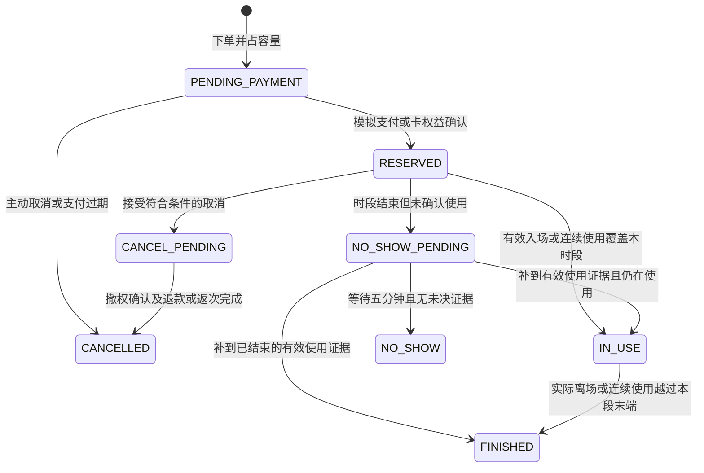
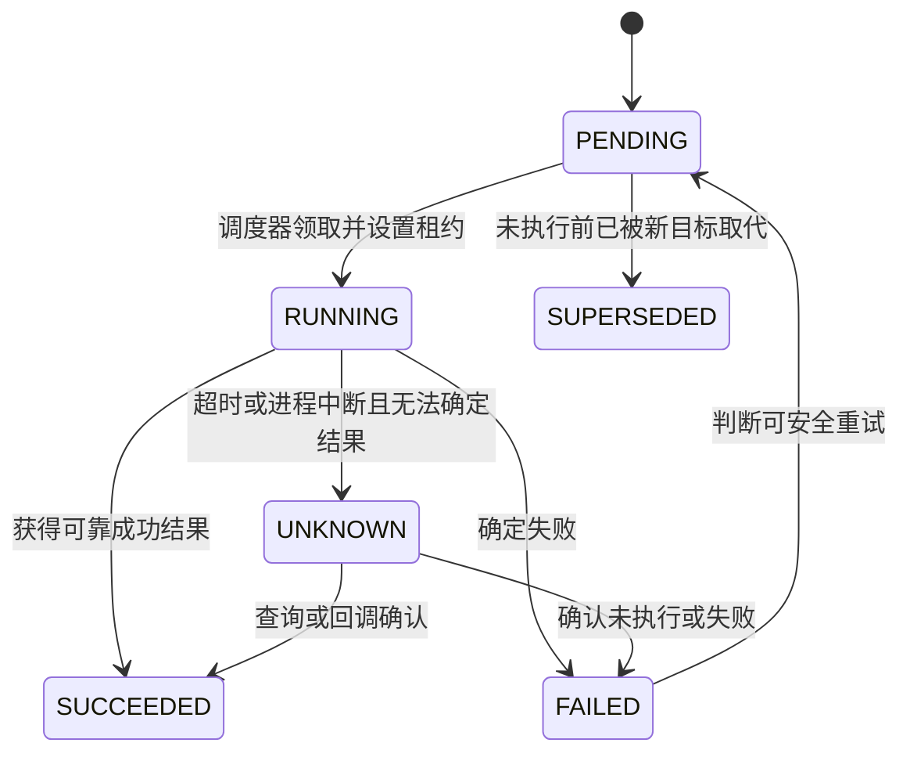

# 无人健身房 SaaS 系统详细设计 v1.1

日期：2026-11-02；数据库与首闭环契约补充及审查修复于 2026-11-12。依据为《业务规则集中审核清单》Q009–Q104 的组内确认结果，以及此前确认的多商家、多门店方向。状态名称和数据组织是本稿提出的实现设计，不是新增业务规则。当前已完成核心对象、状态转换、数据库结构及首个闭环接口定义；2026-11-15补齐[完整接口文档v1.2](接口文档.md)。静态界面设计已提供，业务应用和真实设备协议仍待完成，历史使用关联反向修正的数据库适配及完整OpenAPI同步见新接口文档边界。

实现设计入口：[完整接口文档v1.2](接口文档.md)、[ER图](数据库设计.md)、[字段字典](数据库设计.md)、[建表SQL](../database/schema.sql)、[首闭环OpenAPI](../api/first-loop.openapi.yaml)、[接口与事务说明](数据库设计.md)。具体表名和字段以这些配套文件为准；本文保留逻辑对象与状态原则。

本稿取代旧讨论稿中冲突的设计：支持跨午夜营业；连续预约规则已经通过；卡权益纳入完整目标；预约订单与实际到店分开；不会因一个人超时便无条件暂停整店入场。Q001–Q008 不扩大为本次组内已评审事项。

## 1 当前架构与技术选型

| 部分 | 选型与职责 |
|---|---|
| 顾客小程序 | uni-app、Vue 3、JavaScript，交付微信端 |
| 商家 Web | Vue 3、Vite、Vue Router、Element Plus、JavaScript |
| 业务后端 | Java 21、Spring Boot、Maven，模块化单体 |
| 数据访问 | MyBatis-Plus，复杂查询和条件更新使用 Mapper XML / 自定义 SQL |
| 数据库 | MySQL、InnoDB、utf8mb4；保存业务事实及可恢复任务 |
| Redis | 登录限流、短期扫码凭证、萤石平台 Token 缓存；不作为预约容量或资金的唯一事实来源 |
| 身份认证 | Spring Security、JWT、BCrypt；顾客身份与后台身份分别校验 |
| 调度 | Spring Scheduling，扫描数据库到期项和未完成任务 |
| 视频 | 商家 Web 使用官方 EZUIKit，后端校验设备归属和播放权限 |
| 设备 | Mock 与真实设备适配采用相同业务入口，逐项标识来源 |
| 部署 | Nginx、HTTPS、Docker Compose；实际服务器和平台支持待核实 |
| 接口协作 | Git、OpenAPI；小程序、Web、后端三个工程 |

不引入 Spring Cloud、Nacos、独立 Gateway 或 MQ。依赖准确版本在建项时核实并锁定，本稿不把旧稿的版本号作为已经验证的组合。

后端模块分为账号权限、门店时段、预约订单、卡权益、到店结算、设备接入、统计待办。模块仍在同一个 Java 应用内，可使用本地数据库事务，不建立远程服务调用。

## 2 先分清六类业务记录

| 记录 | 回答的问题 | 不负责的事情 |
|---|---|---|
| 预约订单 `booking_order` | 谁购买了哪个门店的哪个时段，使用什么权益 | 不单独代表一次真实到店 |
| 实际到店 `visit_session` | 谁何时进入、何时离开，确认来源是什么 | 不因跨过整点就新建一次 |
| 到店订单关联 `visit_order` | 本次到店实际使用了哪些预约时段 | 不把未来关联订单提前标为已使用 |
| 收退款与权益流水 | 成功收款、退款、扣次、返次分别发生了什么 | 不通过改原成功记录抹去历史 |
| 通行凭证与设备任务 | 目标权限是什么，设备确认到了哪一步 | 不把发指令等同于实际入场 |
| 结算与复核记录 | 本次到店应补多少，是否存在待复核证据 | 不因欠费把已离场用户记为在场 |

这些逻辑对象已落实为schema v1.1的26张表，精确字段以[数据库设计](数据库设计.md)与SQL为准。原则是一个状态只表达一个维度，避免出现“已离场但欠费，所以订单仍使用中”的混用。

## 3 预约订单状态

对应 Q025、Q030–Q048、Q068–Q078。

| 状态 | 含义 |
|---|---|
| `PENDING_PAYMENT` | 已占名额，预约费或所选权益尚未确认 |
| `RESERVED` | 预约费支付或卡权益确认成功，尚未实际使用该时段 |
| `IN_USE` | 已确认实际到店，且实际使用覆盖当前时段 |
| `FINISHED` | 该订单的实际使用已结束，或连续使用已经越过其结束边界 |
| `CANCEL_PENDING` | 已接受取消申请，正在撤权和退款或返次 |
| `CANCELLED` | 取消所需步骤已完成 |
| `NO_SHOW_PENDING` | 时段结束后未见有效使用，处于补推等待或证据核对阶段 |
| `NO_SHOW` | 无有效使用和未决证据，最终确认爽约 |

图为常规路径，不表示可无条件执行转换；每次转换校验身份、商家、时间、原状态和相关证据。终态后的迟到证据通过复核修正并保留原记录，不套用普通入场接口直接倒退状态。

### 3.1 下单与权益确认

支付截止为 `min(创建时间 + 15分钟, 时段开始时间)`；服务端当前时间必须严格早于截止。请求到达、获得锁后截止已过时，拒绝确认，不采用客户端提交的时间回填。

三种支付权益是 `TIME_FEE`、`COUNT_CARD`、`MONTH_CARD`。次卡在权益确认时扣次，月卡在确认时记录覆盖的卡；两者都要校验本商家归属、整段有效期及冻结状态。卡订单不伪造一笔现金预约费收入。权益确认失败时不得进入 `RESERVED`，已占容量按照取消或过期流程释放。

下单锁定用户后检查所有门店的有效重叠预约，再占时段容量。半开区间 `[start,end)` 的重叠条件为 `existing.start < new.end AND existing.end > new.start`；相邻不重叠。取消处理中的订单仍占容量，在完成取消前保守保留重叠占用。

重复下单请求返回同一订单；更换请求号也不能绕过重叠检查。现金确认、卡权益扣减、订单转换、流水及待处理任务必须在同一个本地事务提交。

### 3.2 订单完成不等于到店结束

连续预约 18:00–19:00、19:00–20:00，第一单到 19:00 可以结束，实际到店仍然继续。第二单在实际使用覆盖其时段后进入 `IN_USE`，不能在 18:10 就提前认定第二单已经使用。

调度器只负责及时反映时间边界，事实判断仍基于到店时间区间和有效订单；调度延迟不能漏掉中间时段，也不能把正在连续使用的第二单误记爽约。

`FINISHED` 和 `NO_SHOW` 不释放已承诺的原时段容量，避免提前结束后再售同一时段。容量释放只发生在符合规则的取消中，并通过占用标记防止重复释放。

## 4 实际到店与连续通行

对应 Q040–Q064、Q093–Q095、Q102。

实际到店只保留 `IN_STORE`、`LEFT` 两个主要状态；是否超时由当前时间与授权结束比较，是否待复核另行记录。生成疑似离场候选不把 `IN_STORE` 改为 `LEFT`。

| 动作 | 必须满足的条件 | 结果 |
|---|---|---|
| 设备确认入场 | 事件可靠，可关联本人、门店、有效订单及入口方向 | 创建一次到店，记录设备发生时间及来源 |
| 本人确认入场 | 当前有效预约、窗口内、近五分钟关联开门成功记录，且未被禁止入场 | 创建一次到店，时间取服务端，来源为本人确认 |
| 连续续时 | 同用户同店、下一段紧接、未开始、容量可用且支付或权益确认成功 | 延长连续通行窗口，不新增到店、不重复计人数 |
| 本人结束或可靠出口事件 | 属于当前有效到店；来源满足规则 | 仅结束一次到店，生成结算或复核任务 |
| 摄像机无告警候选 | 摄像机与消息正常且满足观察期 | 仅创建待复核记录，不自动离场或结算 |
| 商家复核确认离场 | 本商家权限、理由、证据与确认时间 | 记录复核来源，结束到店或修正历史并留痕 |

同一用户在同一门店至多有一次未结束到店；重复入场确认返回现有结果。若上次到店仍未结束，新请求不得制造第二次到店。跨店存在未决在场事实时保留证据并交复核，不凭一条迟到消息自动关闭另一店记录。

连续通行窗口从当前有效订单出发，只向无空档的同店、同用户、已确认权益订单扩展。取消其中一段后重新计算，不能把空档补成有效时间。窗口末端变化必须保留所依据订单，使用最后一段的规则快照计算超时。

提前离场只结束本次到店及已实际使用的订单；未来未开始的后续订单仍为 `RESERVED`，可以再次使用或按取消规则处理。已经结束的当前时段不能再次入场。

### 4.1 连续预约示例

| 时间 | 事实与状态 |
|---|---|
| 17:30 | A 单 18:00–19:00、B 单 19:00–20:00 已确认；两单均 `RESERVED` |
| 18:10 | 确认入场，创建一次到店；A 为 `IN_USE`，B 仍 `RESERVED`，授权末端为 20:00 |
| 19:00 | 若仍在店，A 为 `FINISHED`，B 为 `IN_USE`；不记新入场，不收 A 单超时 |
| 20:03 | 确认离场；到店为 `LEFT`，B 为 `FINISHED`，超时三分钟，仅计一次到店 |

若改为 18:40 离场，B 未使用，继续保留；用户在 19:10 持 B 再入场时创建第二次到店。

## 5 已支付取消的处理阶段

对应 Q047、Q069–Q074、Q081、Q084、Q087。

订单始终保持 `CANCEL_PENDING`，另用取消阶段表示处理进度，避免塞入过多订单状态。

| 阶段 | 动作 | 进入下一步的条件 |
|---|---|---|
| `REVOKE_PENDING` | 冻结该订单的新入场和下发；计算取消后的剩余权限，建立回收或缩短有效期任务 | 设备确认目标订单不再提供通行权，或确认从未下发且无在途指令，或有经验证的失效证据 |
| `RETURN_PENDING` | 现金退款、次卡返次；月卡预约解除覆盖关系，不退整张卡 | 收退款或权益流水与取消事务成功完成 |
| `COMPLETED` | 订单变为 `CANCELLED`，释放一次预约容量 | 前述阶段均成功 |

自助资格在接受申请时锁定并记录：未开始且未入场。随后跨过预约开始时间，不因后台处理耗时剥夺已接受资格。

回收未知超过五分钟生成商家待办并通知用户，仍停在回收阶段；退款失败则停在返还阶段。均展示真实进度，不自动回到 `RESERVED` 或宣布取消完成。

连续订单共享凭证时只撤掉目标订单不再需要的时间段，不能误删其他订单权限。若厂商只能提供有限数量的有效期区间，适配层必须如实暴露限制，不把分开的窗口合并成中间可进的长窗口。

取消后收到发生在取消前的可靠入场事件，保存事件并转复核，暂停尚未执行的自动退款与释放；已经成功的退款保留原事实，再按复核结果调整。不能丢弃迟到事件，也不能自动扣回已经退款的金额。

## 6 通行凭证与设备命令

对应 Q085–Q092、Q096–Q098。

### 6.1 凭证目标与观察结果

凭证分别记录目标有效区间及目标版本 `generation`，并记录厂商已确认的实际结果。无有效区间表示目标是撤销。不能仅用 `ACTIVE/REVOKED` 表达连续订单的区间缩短。

观察状态为 `NOT_GRANTED / GRANTING / ACTIVE / REVOKING / REVOKED / FAILED / UNKNOWN`。其中 `ACTIVE` 只有在已确认区间符合当前目标版本时才代表同步完成；目标变更后不能沿用旧成功结果宣称新目标已生效。失败和未知均保留动作、版本、错误及待办。

设备回收确认与本地时间过期分开记录；仅有经过验证的厂商有效期行为，才可作为取消中的失效证据。下发窗口为预约前 30 分钟，凭证有效窗口仍从预约开始算。

### 6.2 设备任务状态

结果超时并不证明未执行。开门 `UNKNOWN` 不自动重发；凭证下发、撤销优先查询现状，只有按真实协议验证可以安全重试时才重试。租约过期的 `RUNNING` 先按可能已执行处理，不能一律重置为待执行。

厂商接口返回“已接收”只记录接收事实，不能直接归为执行成功。旧版本下发晚到成功时，记录结果并重新执行当前回收目标，不恢复已取消订单。

所有调用在数据库事务外进行：先保存任务并提交，再调用平台，最后独立事务记录结果。任务重启可恢复，不需要 MQ，也不持有数据库锁等待厂商网络响应。每次领取递增attempts作为fencing版本，结果回写须匹配领取版本、业务generation及未过期租约；同设备最多一个RUNNING，同订单最多一个未决OPEN。

### 6.3 Mock 验证场景

至少支持立即成功、明确失败、执行后响应超时、重复回调、延迟回调、离线恢复六种场景。每个场景走真实业务校验、状态更新和日志；只替换外部设备响应，不直接把订单设置成期望结果。

## 7 到店结算与资金权益

对应 Q061–Q067、Q074、Q079–Q084、Q101。

| 结算状态 | 含义 |
|---|---|
| `NOT_READY` | 在场，金额仅供预估 |
| `REVIEW_REQUIRED` | 离场或计费证据冲突，不能自动确认最终收费 |
| `PAYMENT_DUE` | 已确认离场与最终金额，存在超时待补缴 |
| `SETTLED` | 已确认金额且无剩余应付 |

无可靠离场事实时，即使已有疑似离场待办，到店仍为 `IN_STORE`，结算保留 `NOT_READY` 并附复核标记。已确认离场但时间证据冲突时可以是 `LEFT + REVIEW_REQUIRED`；结算状态不控制物理出门。

超时分钟 = `ceil(max(0, exitAt - authorizedEndAt) / 60秒)`；超时费用取分钟单价乘积与封顶额的较小值，使用末段订单快照。金额使用整数分，时段费、扣次或月卡覆盖记录在各订单，超时补缴记在本次到店，不能每单重复计算一次。

提前离开不退已使用时段费；爽约保留预约费或扣次，不生成实际到店和超时费用。未付超时费限制该商家新预约，但不自动撤掉已有已支付订单。

流水区分现金收款退款与卡权益扣次返次。次卡返还关联原扣次记录且至多返还一次；恢复扣次不延长卡有效期。月卡预约取消不等于退整张卡。

卡本身退卡先冻结相关权益，检查关联预约和已使用事实，再确定可执行方案；有未来已确认订单时不能直接退卡并留下无权益来源的预约。涉及这些预约的具体解除与用户确认步骤在卡权益接口设计中展开，不新增自动批量取消规则。

已结算后发现错误，新增调整、退款或补缴记录，保留旧结算依据，不覆盖原成功支付。收退款和权益确认均要处理重复提交，不能仅依赖客户端按钮禁用。

## 8 跨状态一致性与隔离

| 场景 | 需要保证的行为 |
|---|---|
| 支付与过期取消并发 | 同一事务检查截止和订单状态，至多一个方向成功 |
| 取消与入场并发 | 串行校验订单；接受取消后拒绝新的本地开门与本人确认，迟到设备事实转复核 |
| 两个相邻订单合并或拆分 | 对同用户同门店的有效订单和到店串行计算权限，更新目标版本 |
| 手动离场与出口事件重复 | 同一次到店仅结束一次；不同时间证据按 Q057 处理 |
| 重复厂商回调 | 先可靠落库去重，再用业务条件更新防重复；无可靠 ID 不盲目吞掉不同事件 |
| 商家访问订单或设备 | 从后台登录身份确定商家，再检查资源归属，不能直接信任请求 merchantId |
| 顾客查询全部订单 | 按登录用户查询本人的跨商家订单，不暴露其他顾客数据 |
| 回调与定时任务 | 根据登记设备或任务所属商家建立上下文，不假设有用户登录身份 |
| Redis 数据过期或不可用 | 不丢订单、资金、权益及设备任务；不能因限流故障放弃核心业务校验 |

对这些相互竞争的业务写操作，建议统一先锁全局顾客记录，随后按固定顺序锁相关门店、时段、订单、卡和到店记录；同类多记录按 ID 排序。实际锁清单须在 DDL 和各接口事务设计时逐一列出，不在定时任务中反向先锁订单再锁用户。普通预约对门店配置使用共享锁，准入使用门店排他锁；最终资格与重叠检查使用当前读。具体顺序、fencing、回滚与资金约束以[事务与查询约定v1.1](数据库设计.md)为准，不沿用本段概述推断所有锁均为排他锁。

灯控任务另按门店串行检查待复核、在场、消息健康、告警及人工覆盖状态；延迟五分钟后执行前重新校验。设备网络调用仍在事务外；新事件须作废尚未执行的旧关灯任务，已经在途时保留记录并按最新目标纠正，不承诺跨网络原子执行。

## 9 核心验收用例

这些是后续实现的检查清单，当前未运行，不表示已经通过。

| 编号 | 输入或竞争场景 | 预期结果 |
|---|---|---|
| S01 | 两人争最后一个名额 | 至多一单成功占容量 |
| S02 | 同用户同时下两个跨店重叠预约 | 至多一单占用；相邻预约均可成立 |
| S03 | 恰在支付截止时确认，且过期任务同时执行 | 不接受截止时刻及之后支付，只释放一次 |
| S04 | 18–19、19–20 连续使用到 20:03 | 两单、一次到店、三分钟超时；不在 19 点重复入场 |
| S05 | 同上但 18:40 离场，19:10 再入场 | A 已结束；B 保留并建立第二次到店 |
| S06 | 取消中撤权超时超过五分钟 | 仍取消处理中，生成待办，不能提前退款或释放 |
| S07 | 取消 B 时 A 仍有效 | 保留 A 权限，不能删除整个共享人员权限 |
| S08 | 下发超时后取消，旧成功回调晚到 | 不恢复订单，重新核对并回收旧权限 |
| S09 | 开门命令执行后响应丢失 | 结果未知，不自动重复开门，也不直接记入场 |
| S10 | 本人结束与出口事件并发或时间有差异 | 一次离场；记录来源并按时间差及结算状态决定复核 |
| S11 | 摄像机十五分钟无告警 | 仅疑似离场，不自动结束或收费；状态未知不自动关灯 |
| S12 | 次卡重复确认或重复取消 | 只扣一次、只返一次；不产生虚构现金流水 |
| S13 | 月卡到期在预约中间 | 该卡不能覆盖本订单 |
| S14 | 已爽约后补到可靠入场证据 | 保留证据并复核冲正信用与账单，不直接丢弃 |
| S15 | 商家 A 用商家 B 的订单或设备 ID | 拒绝操作；顾客仍可查本人跨商家订单 |
| S16 | 跨午夜使用，零点调度运行 | 不自动结束到店，时长分日统计 |

## 10 后续交付

ER图、字段字典、MySQL DDL及首闭环OpenAPI已于2026-11-12补充，见文首链接。下一步按接口契约搭建后端并实现首闭环，再扩展卡权益、复核操作、统计和真实设备接口；已有业务规则不因分迭代而删除。

尚需在详细接口设计中落定：卡本身退款与关联预约的交互步骤、复核修正终态的权限与字段、设备真实报文去重依据及多个有效区间的支持能力。这些是实现细节或外部能力核实，不推翻已经确认的业务规则，也不假设设备已具备所需能力。

## 11 界面与实现入口

静态界面说明与8张设计板见[界面设计](ui/README.md)，图稿浏览见[本地目录](ui/index.html)；图片不是已实现功能。开发分工按[接口文档第19章](接口文档.md#implementation-classification)的基础CRUD、复杂查询、业务事务、外部异步和测试入口安排。
